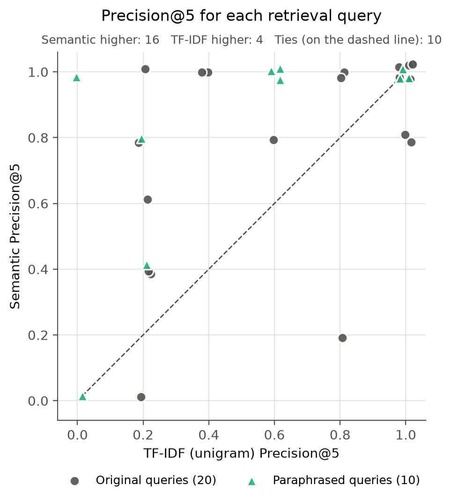

# Retrieval and Search (Member 5)

## Handoff Summary

In this section, the deliverables of the retrieval component are summarised (Table 1). The following components add value beyond the board label alone:

- **Related reports:** `retrieve()` shows earlier reports of the same type of need, damage or situation.
- **Keyword search:** `search()` returns every report containing the words a user types.
- **Duplicate grouping:** repeated copies of one message are shown as a single result.

| File | Contents |
| --- | --- |
| **models/retrieval/** | |
| `retrieval.py` | Retrieval functions: `retrieve()`, `search()`, `add_to_index()`, `warm_up()`, `reset_index()` |
| `build_index.py` | Index builder |
| `README.md` | Usage guide |
| **notebooks/member5/** | |
| `retrieval_experiments.ipynb` | Evaluation: query set, relevance judging, method comparison and checks |
| **outputs/results/retrieval/** | |
| 7 result files | Queries, 1,427 judgements, rankings, comparison results |
| **report/sections/** | |
| `member5_retrieval.md` | Evaluation summary written for the group report |

Table 1 Files delivered for the retrieval component (by folder)

## 1. Text Preparation

Table 1.1 summarises the cleaning steps applied to the HumAID messages (Alam et al., 2021) before ranking and duplicate grouping.

| Step | Example | Affected | Why it matters |
| --- | --- | --- | --- |
| Repair HTML codes and emoji | `&amp;` → &; ὢ2 → 😢 | 7,036 (9.2%); 4,989 (6.5%) | Text displays as written; "amp" is not indexed as a word |
| Lowercase | Flood → flood | 76,146 (99.6%) | Capitals do not block a match |
| Remove retweet markers, @user and links | RT @user: text → text | 10,898 (14.2%); 29,324 (38.3%); links in 5 messages | Names carry no situation information; without them a retweet reaches 0.90 and is grouped with its original |
| Keep hashtag words | #KeralaFloods → keralafloods | 43,137 (56.4%) | Hashtag event and topic words stay available to both methods |
| Collapse repeated spaces | Double spaces and line breaks → one space | 8,418 (11.0%) | Copies differing only in spacing are identical |

Table 1.1 Cleaning steps applied before ranking and duplicate grouping

*Note: Counts are messages containing the pattern, out of 76,484. The original text is kept separately for display.*

## 2. Retrieval and Search Methods

In this section, the NLP methods adopted in the retrieval component are summarised in Table 2.1.

| Task | Method adopted | Key settings | Justification |
| --- | --- | --- | --- |
| Word matching | TF-IDF with cosine similarity | Unigram is selected over unigram + bigram Words in at least 2 messages (min_df = 2) Sublinear term frequency, L2 normalisation | Strongest on exact words, names and numbers (Sciavolino et al., 2021) |
| Meaning matching | Sentence embeddings with cosine similarity (Reimers & Gurevych, 2019) | all-MiniLM-L6-v2 (Wang et al., 2020) 384 numbers per message, normalised | Matches the same situation in different words Five times faster than all-mpnet-base-v2, so it runs on a CPU (Sentence Transformers, n.d.) |
| Keyword search | TF-IDF word matching | Every word kept in the index (min_df = 1) | Every result contains a typed word A name in a single message is still found Keyword lexicons are an established way of collecting crisis messages (Olteanu et al., 2014) |
| Copy grouping | Near-duplicate detection by TF-IDF similarity | Threshold 0.90 on cleaned text Grouped messages listed, not removed | Retweets and re-posts would otherwise fill the first results |

Table 2.1 NLP methods adopted in the retrieval component

*Note: `retrieve()` and `search()` both apply the filters by board, source, status, review flag, location and posting date after ranking (Appendix D).*

## 3. Evaluation Design

In this section, the queries, the manual judgement rule, the measures and the selection rules are stated. All were fixed before any final result was seen.

### 3.1 Queries and Manual Judgement

In this section, the queries and the manual judgement rule are described (Table 3.1.1).

| Group | Queries | Source | Use |
| --- | --- | --- | --- |
| Tuning | 10 | Validation tweets, one per HumAID label | Selecting the TF-IDF setting |
| Final original | 20 | Test tweets, two per label | Comparing both methods for `retrieve()` |
| Final paraphrased | 10 | One rewording of an original query per label | Testing matching by meaning |
| Final search | 9 | Short keyword searches, three with a filter | Measuring the precision of `search()` |

Table 3.1.1 Query set

*Note: During the evaluation, both methods search the training and validation messages only (61,324), which means no test query is part of the messages being searched.*

- **Relevance rule:** a returned message is relevant when it describes the same type of need, damage or situation as the query, or, for a search, when it is about the searched topic.
- **Manual judgement:** the top 20 results of both methods were pooled and judged once each, in random order and without the method name, giving 1,427 judgements (163 tuning, 1,264 final).

### 3.2 Measures and Selection Rules

In this section, the measures and the three selection rules are stated (Tables 3.2.1 and 3.2.2).

| Measure | Definition | Role |
| --- | --- | --- |
| Precision@5 | Share of the top 5 results that are relevant | Primary: users read the first few related reports |
| Precision@10 | Share of the top 10 results that are relevant | Supporting |
| Pooled Recall@5, @10 | Share of all relevant messages found by either method that appear in the top 5 or 10 | Supporting |
| Mean query time | Average time to answer one query, model loading excluded | Limit of 200 ms for interactive use |

Table 3.2.1 Evaluation measures

| Decision | Rule | Reported in |
| --- | --- | --- |
| TF-IDF setting | Unigram is kept unless unigram and bigram together raise Precision@10 on the tuning queries by 0.05 or more | 4.1 |
| Method for `retrieve()` | Semantic retrieval is selected only if all three hold, otherwise TF-IDF is kept: Precision@5 at least 0.05 higher than TF-IDF over the 30 queries; at least as high as TF-IDF in at least 6 of the 10 categories; mean query time of 200 ms or less | 4.1 |
| Duplicate threshold | The highest of 0.80, 0.85, 0.90 and 0.95 that catches at least 95% of test copies with at most 1% of other results grouped | 4.3 |

Table 3.2.2 Selection rules

*Note: A gain of 0.05 in Precision@5 corresponds to around eight more relevant results among the 150 shown; the category condition stops one or two categories from deciding the result alone.*

## 4. Results

### 4.1 Related Reports: `retrieve()`

**TF-IDF setting.** In this section, the two TF-IDF settings are compared on the 10 tuning queries (Table 4.1.1).

| Setting | Words in index | Precision@5 | Precision@10 | Selected |
| --- | --- | --- | --- | --- |
| Unigram | 20,242 | 0.64 | 0.63 | Yes |
| Unigram + bigram | 113,949 | 0.72 | 0.65 | No |

Table 4.1.1 TF-IDF settings compared on the tuning queries

As shown in Table 4.1.1, adding bigrams increased the vocabulary by more than five times, but improved Precision@10 by only 0.02 (0.65 versus 0.63), which was below the predefined 0.05 selection threshold. Although the unigram–bigram setting achieved a higher Precision@5 (0.72 versus 0.64), this result was based on only ten tuning queries and may not be stable. The unigram setting was therefore retained because it provided comparable performance with substantially lower complexity.

**Precision and recall.** In this section, the two methods are compared on the 30 final retrieval queries (Table 4.1.2 and Figure 4.1.1).

| Method | Precision@5 | Precision@10 | Pooled Recall@5 | Pooled Recall@10 |
| --- | --- | --- | --- | --- |
| TF-IDF (unigram) | 0.607 | 0.577 | 0.161 | 0.269 |
| Semantic | 0.800 | 0.773 | 0.191 | 0.354 |

Table 4.1.2 Performance of both methods on the 30 final queries

Table 4.1.2 shows that semantic retrieval outperformed TF-IDF across all reported precision and pooled-recall measures. At Precision@5, semantic retrieval achieved 0.800 compared with 0.607 for TF-IDF. The advantage was larger for the ten paraphrased queries (0.82 versus 0.52), which is consistent with TF-IDF's reliance on shared words, as illustrated in Appendix A. Nevertheless, pooled recall remained modest because 27 of the 30 queries had more than ten relevant messages in the judged pool, meaning that a top 10 result list could not retrieve all relevant messages.

Figure 4.1.1 Precision@5 by humanitarian category (three queries per category)

As shown in Figure 4.1.1, semantic retrieval records an equal or higher Precision@5 in nine of the ten categories, with the largest gains in requests or urgent needs (0.40 to 0.93) and caution and advice (0.27 to 0.80). Query by query, it is higher on 16 of the 30 queries, equal on 10 and lower on 4 (Appendix C). Not humanitarian is the only category where TF-IDF records the higher value (0.40 against 0.33), which may be due to its queries sharing exact words with many messages, such as "aftershocks". As each category rests on three queries, the category results are indicative, while the query-level count carries the comparison.

**Query time and resources.**

| Measure | TF-IDF (unigram) | Semantic |
| --- | --- | --- |
| Mean query time (ms) | 28.1 | 34.0 |
| Index build time (s) | 0.6 | 123.5 |
| Index size (MB) | 14.4 | 94.2 |
| Model loading time (s) | 0.0 | 8.1 |

Table 4.1.3 Query time and one-off costs of both methods

Based on Table 4.1.3, both methods answer a query in under 35 ms, while the larger costs of semantic retrieval, the index build and the model loading, occur once when the application starts rather than per query.

**Method selection.** In this section, the three selection conditions are applied to the results above (Table 4.1.4).

| Condition | Result | Met |
| --- | --- | --- |
| Precision@5 gain of at least 0.05 | +0.193 | Yes |
| Equal or higher in at least 6 of 10 categories | 9 of 10 | Yes |
| Mean query time of 200 ms or less | 34.0 ms | Yes |

Table 4.1.4 Selection conditions for `retrieve()` and their outcome

**Semantic retrieval** is selected for `retrieve()`, as all three conditions are met, with not humanitarian as its one weaker category; TF-IDF remains available through `method="tfidf"`.

### 4.2 Keyword Search: `search()`

In this section, `search()` is evaluated on nine keyword searches (Table 4.2.1) and on searches for names (Table 4.2.2).

**Keyword searches.**

| Searches | Precision@5 | Precision@10 |
| --- | --- | --- |
| All nine keyword searches | 0.756 | 0.733 |

Table 4.2.1 Mean precision of `search()` on the nine keyword searches

Based on Table 4.2.1, `search()` reaches a mean Precision@5 of 0.756, while searches made of common words such as "needed" record low precision, as TF-IDF also ranks messages sharing one word. In this case, users should search with specific words and add a board filter.

**Name searches.** In this section, 20 names were drawn at random from each group, a name being a word written with a capital first letter in at least 90% of its uses, and each name was searched with word matching and with semantic retrieval (Table 4.2.2).

| Name appears in | Names in collection | TF-IDF (all words) | Semantic |
| --- | --- | --- | --- |
| 1 message | 6,607 | 1.00 | 0.35 |
| 2 to 5 messages | 2,610 | 1.00 | 0.45 |
| 6 to 20 messages | 727 | 1.00 | 0.31 |
| 21 to 100 messages | 326 | 1.00 | 0.49 |
| Over 100 messages | 112 | 1.00 | 0.60 |

Table 4.2.2 Name found@10 by how many messages contain the name

*Note: Name found@10 is the share of the messages containing the name, up to 10, that appear in the top 10 results.*

Based on Table 4.2.2, TF-IDF returns every message containing the searched name in every group, while semantic retrieval finds only 31% to 60% of them, supporting the choice of word matching for `search()`.

### 4.3 Both Functions: Duplicate Grouping and Filters

In this section, the duplicate grouping and the filters are checked automatically (Table 4.3.1). Grouping is tested with 90 copies made from 30 messages (a retweet prefix, a link, or changed capitals and punctuation) and with the 52 copies already in the dataset, while each of the 29 filter checks confirms that a filter returns only the reports it asks for.

| Check | Tested on | TF-IDF | Semantic |
| --- | --- | --- | --- |
| Test copies grouped with their original | 90 copies | 100% | 100% |
| Other results grouped | 200 tuning results | 4.0% | 4.0% |
| Existing copy found in the top 5 | 52 copies in the dataset | 100% | 94.2% |
| Distinct results in the top 10, grouping on | 30 originals | 10 of 10 | 10 of 10 |

Table 4.3.1 Duplicate grouping checks for both methods

Based on Table 4.3.1, every test copy is grouped with its original at every threshold from 0.80 to 0.95, while 4.0% of other results would be grouped at any threshold, above the 1% limit. As these are near-identical prayer messages (Appendix B), 0.90 is kept. Grouping raises the distinct results in the top 10 from 7 to 10 for both methods, and all 29 filter checks pass.

## 5. Conclusion

This report delivered the retrieval and search functions of CrisisLens, evaluated with 1,427 manual relevance judgements on 76,484 HumAID messages.

Semantic retrieval with all-MiniLM-L6-v2 was selected for `retrieve()` (Precision@5 of 0.800 against 0.607), while `search()` adopts TF-IDF word matching (Precision@5 of 0.756) and returns every message containing a searched name.

**Limitations and future work:**

- **Small query set:** Only three retrieval queries per category were judged, so category results are indicative, and queries from the user study could be added.
- **One general-purpose model:** Only one compact model without crisis-specific training was tested, and the CrisisTransformers sentence encoders (Lamsal et al., 2024) could be compared under the same protocol.
- **Word matching in `search()`:** `search()` matches whole words only, and combining keyword and semantic scores (Bruch et al., 2023) could improve searches describing a topic.

To conclude, the retrieval component returns relevant and distinct reports within an interactive response time, and is ready for integration by the backend.

## References

Alam, F., Qazi, U., Imran, M., & Ofli, F. (2021). HumAID: Human-annotated disaster incidents data from Twitter with deep learning benchmarks. *Proceedings of the International AAAI Conference on Web and Social Media, 15*(1), 933–942. https://doi.org/10.1609/icwsm.v15i1.18116

Bruch, S., Gai, S., & Ingber, A. (2023). An analysis of fusion functions for hybrid retrieval. *ACM Transactions on Information Systems, 42*(1), Article 20. https://doi.org/10.1145/3596512

Lamsal, R., Read, M. R., & Karunasekera, S. (2024). CrisisTransformers: Pre-trained language models and sentence encoders for crisis-related social media texts. *Knowledge-Based Systems, 296*, 111916. https://doi.org/10.1016/j.knosys.2024.111916

Olteanu, A., Castillo, C., Diaz, F., & Vieweg, S. (2014). CrisisLex: A lexicon for collecting and filtering microblogged communications in crises. *Proceedings of the International AAAI Conference on Web and Social Media, 8*(1), 376–385. https://doi.org/10.1609/icwsm.v8i1.14538

Reimers, N., & Gurevych, I. (2019). Sentence-BERT: Sentence embeddings using Siamese BERT-networks. In *Proceedings of the 2019 Conference on Empirical Methods in Natural Language Processing and the 9th International Joint Conference on Natural Language Processing* (pp. 3982–3992). Association for Computational Linguistics. https://doi.org/10.18653/v1/D19-1410

Sciavolino, C., Zhong, Z., Lee, J., & Chen, D. (2021). Simple entity-centric questions challenge dense retrievers. In *Proceedings of the 2021 Conference on Empirical Methods in Natural Language Processing* (pp. 6138–6148). Association for Computational Linguistics. https://doi.org/10.18653/v1/2021.emnlp-main.496

Sentence Transformers. (n.d.). *Pretrained models*. Retrieved October 3, 2026, from https://www.sbert.net/docs/sentence_transformer/pretrained_models.html

Wang, W., Wei, F., Dong, L., Bao, H., Yang, N., & Zhou, M. (2020). MiniLM: Deep self-attention distillation for task-agnostic compression of pre-trained transformers. *Advances in Neural Information Processing Systems, 33*, 5776–5788.

## Appendices

### Appendix A – Worked Example: Paraphrased Query P01

Paraphrased query P01: "Advice on staying safe on the road when streets are under water", rewritten from the original query F01 ("Safe driving tips during floods #KeralaFloods #safedriving").

| Rank | Semantic result | Relevant | TF-IDF (unigram) result | Relevant |
| --- | --- | --- | --- | --- |
| 1 | On flooded roads, as little as 6 inches of water can cause you to lose control of your car or truck. Two feet of water will carry most cars away... | 1 | #NotFake #CaliforniaDreamin under water! | 0 |
| 2 | Don't drive through flooded areas & standing water. Learn more about staying safe during a #flood. #HurricaneHarvey | 1 | @user @user @user Looks like a good time to flood the road with water and wash the streets clean. | 0 |
| 3 | Do NOT drive through or walk into flooded areas & standing water. Learn more abt staying safe during a #flood. #Irma | 1 | I'm staying on the coast . F\*\*\* a evacuation | 0 |

Table A.1 Top three results of each method for P01

*Note: Usernames are replaced with @user and offensive words are masked.*

The semantic results describe the same advice as the query without sharing its wording, while each TF-IDF result shares one or two query words ("under water", "road", "staying") in an unrelated context.

### Appendix B – Duplicate Examples

| Kept result | Would be grouped | Similarity |
| --- | --- | --- |
| Pray for #Kerala 🙏🙏 | Pray for Kerala. #railwayminister | 1.000 |
| Pray for Bahamas 🇧🇸🙏🏽🙏🏽🙏🏽 | RT @user: Pray for Bahamas 🙏🏾 | 1.000 |
| Pray for Bahamas 🇧🇸🙏🏽🙏🏽🙏🏽 | RT @user: pray for the bahamas 🙏🏽😔 | 0.973 |
| Pray for Bahamas 🇧🇸🙏🏽🙏🏽🙏🏽 | Pray for the Bahamas 👏🏼👏🏽🇧🇸👏🏾👏🏿 | 0.973 |

Table B.1 Examples of the eight potential groupings in the tuning results

All eight potential groupings are short prayer messages whose cleaned text differs only in emojis, the word "the" or a rare hashtag, so showing them separately would repeat the same message.

### Appendix C – Precision@5 for Each Retrieval Query

Figure C.1 Precision@5 of both methods for each of the 30 retrieval queries

Figure C.1 plots the Precision@5 of both methods for each retrieval query, with points above the dashed line showing queries where semantic retrieval records the higher value. Semantic retrieval is higher on 16 queries, the two methods are equal on 10, and TF-IDF is higher on 4 (F10, F11, F13 and F19).

### Appendix D – Filters Supported by `retrieve()` and `search()`

| Filter | Applies to | Behaviour |
| --- | --- | --- |
| board_label, source_type | All messages | Exact match |
| status, needs_review | User reports | Exact match |
| country, region, city | User reports | Match ignoring capitals and surrounding spaces |
| created_after, created_before | All messages | Posting time on or after, and on or before, the given date |

Table D.1 Filters supported by `retrieve()` and `search()`

*Notes:*

- **All messages:** historical HumAID tweets and user reports alike, as every record carries a board, a source and a posting time.
- **User reports:** reports submitted through the app only, as status, review flag and location are not recorded for historical tweets.
