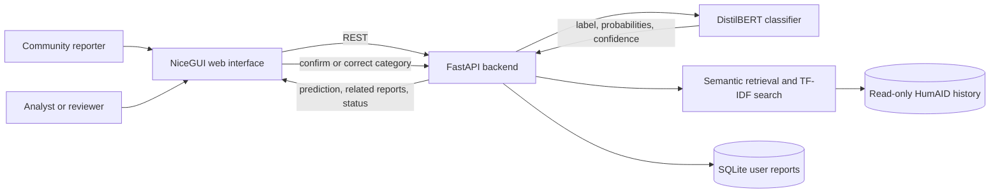
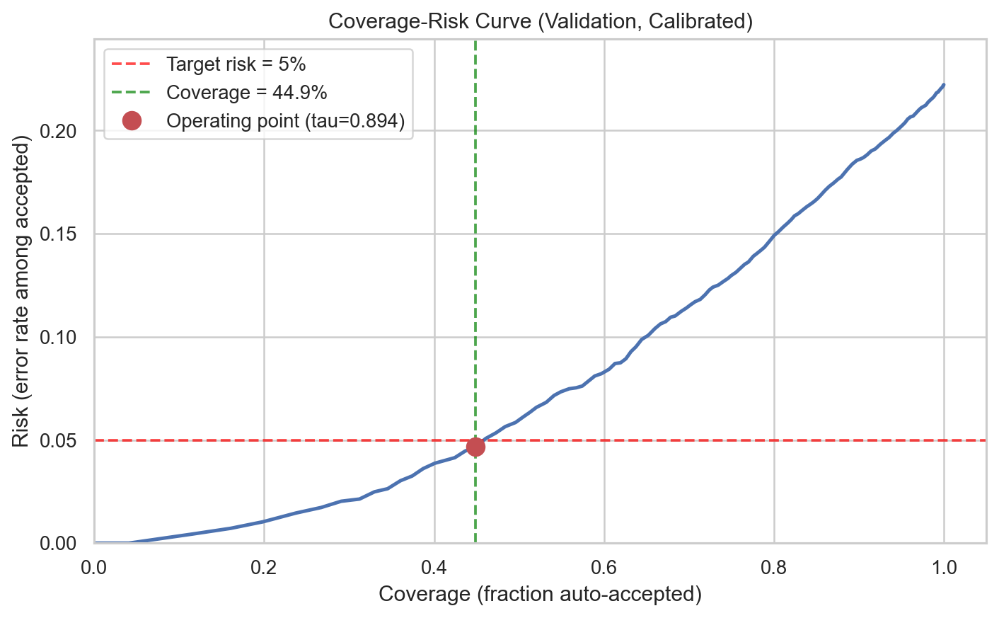
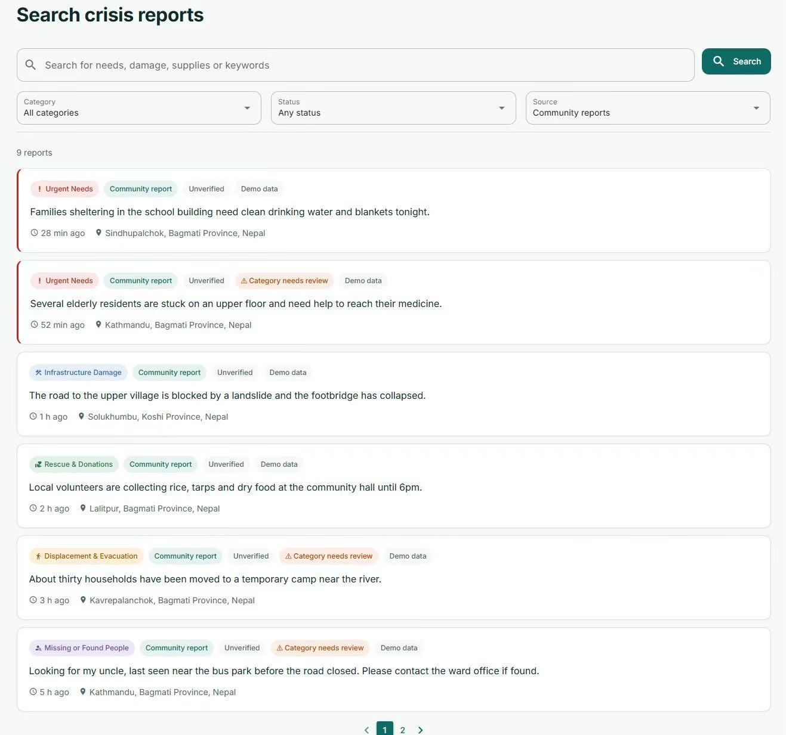

# CrisisLens: Human-in-the-Loop Classification and Retrieval for Crisis Messages

**36118 Applied Natural Language Processing — Assignment 2**  
**Group:** 02
**Authors:** Jiayu Hao (25948860); Kamali Siddharthan (26043669); Xin Yiing Loo (26178069); Kunal Mistry (25734346); Sze Xuan Yap (25763158); Lujia Ouyang (25673411)
**GitHub repository:** [Rainbow6174/36118-ANLP-AT2](https://github.com/Rainbow6174/36118-ANLP-AT2)

## Executive summary

People use social media to share warnings, damage reports, requests and offers during disasters, but the resulting stream is difficult to organise quickly. CrisisLens is a web-based NLP prototype that turns a new English crisis message into a structured, searchable report. It predicts one of ten humanitarian categories, shows the prediction and its confidence, allows a person to correct the category, saves the report to the relevant board and retrieves related messages from earlier disasters. Low-confidence predictions enter a review queue. The system organises information; it does not verify whether a report is true or dispatch emergency help.

The project compared a transparent word-and-character TF-IDF baseline with DistilBERT and Twitter-RoBERTa. On the official HumAID test set, macro-F1 increased from 0.7262 for the baseline to 0.7547 for DistilBERT and 0.7621 for Twitter-RoBERTa. DistilBERT was selected for the application because it gave up only 0.0074 macro-F1 while taking roughly half the training and inference time of Twitter-RoBERTa in the saved experiments. Temperature scaling and confidence-based selective prediction were added so that uncertain cases could be sent to human review.

Generalisation was tested by removing `cyclone_idai_2019` from training and evaluating on its 779 test messages. Under this shift, macro-F1 was 0.5760 for the TF-IDF baseline, 0.6969 for DistilBERT and 0.718 for Twitter-RoBERTa. Calibration learned on seen events did not transfer consistently: the frozen temperature improved DistilBERT's expected calibration error (ECE) on the held-out event but worsened it for Twitter-RoBERTa. For this reason, confidence is used to route messages for review and is not treated as a guarantee.

For related-message retrieval, semantic search with `all-MiniLM-L6-v2` achieved Precision@5 of 0.800, compared with 0.607 for TF-IDF, while answering a query in 34 ms on average after loading. TF-IDF remained the better method for exact keyword and name search. The integrated FastAPI and NiceGUI application completed classification, saving, board navigation, search and correction through stable interfaces. Twenty-eight automated tests and fourteen live failure scenarios passed.

## 1. Project objectives and scope

### 1.1 Problem and users

HumAID was created because high-volume social-media content during disasters is noisy and difficult to use directly (Alam et al., 2021). CrisisLens addresses the narrower problem of turning an individual English crisis message into information that can be browsed and reviewed.

The primary users are volunteer crisis-information coordinators and humanitarian information analysts who need to sort and inspect public reports. Community members are secondary users who submit a message and review the suggested category. Other readers can browse boards or search historical examples. The workflow supports both the person providing information and the person reviewing it.

The project objective was:

> To test whether a human-in-the-loop NLP workflow can classify a new English crisis message, place it in a useful humanitarian board, retrieve related historical messages and expose uncertainty clearly enough for a person to confirm or correct the result.

Four research questions guided the work:

1. How much do contextual Transformers improve ten-class humanitarian classification over a transparent lexical baseline?
2. How well do classification performance, calibration and review thresholds transfer to an unseen disaster event?
3. Does semantic retrieval provide more relevant historical context than TF-IDF without losing interactive speed?
4. Can these components support a clear submit–review–publish–browse workflow in a web application?

### 1.2 Scope and boundaries

The minimum product accepts one English message at a time, predicts one of ten HumAID categories, records model confidence and version, allows category correction, saves the report, redirects to its board and displays related historical messages. It also provides keyword search, board and source filters, and a review queue for uncertain predictions.

The prototype does not determine urgency, verify facts, coordinate emergency response or replace official sources. It currently supports English only. Location is optional and approximate. These boundaries are stated in the interface because a category prediction is a sorting suggestion, not evidence that the message is accurate.

### 1.3 Positioning and project contribution

CrisisLens combines message classification, confidence-based review, category boards and historical-message retrieval. CrisisNLP provides datasets and benchmarks, while ReliefWeb distributes professionally curated humanitarian information (CrisisNLP, n.d.; ReliefWeb, n.d.). AIDR and Ushahidi are closer system comparisons. AIDR uses crowdsourcing and machine learning to classify crisis microblogs in real time (Imran et al., 2014). Ushahidi allows people to submit and map reports during crises (Okolloh, 2009).

CrisisLens focuses on how these functions work together. Calibrated confidence routes uncertain messages to review. The predicted category sets the board used for the first historical search, and a person can change that category before publication. Once saved, the report becomes available to later searches. The project evaluates this combined workflow through classification, calibration, retrieval and system tests.

| Existing approach | Strength | Gap explored by CrisisLens |
| --- | --- | --- |
| CrisisNLP benchmarks | Supply crisis datasets, tasks and model comparisons | Do not by themselves provide the report-to-board workflow tested here |
| ReliefWeb | Provides professionally curated humanitarian information | Serves a different publishing process from immediate community submission and sorting |
| AIDR | Combines real-time crisis-message classification with human labelling | CrisisLens instead evaluates a fixed ten-label model, calibrated review routing and historical retrieval in one user journey |
| Ushahidi | Collects and maps crowdsourced crisis reports | CrisisLens focuses on NLP-assisted category assignment and related-message retrieval before and after publication |
| CrisisLens | Connects confidence, review, boards and retrieval and evaluates each link | Remains a student prototype; adoption would require moderation, staffing, security, monitoring and wider field validation |

Each part was evaluated with a matching measure. Classification used macro-F1 and per-label results; confidence handling used calibration and risk–coverage; retrieval used Precision@K; and the integrated system used response-time, API and failure tests.

## 2. Project phases and team contributions

The work was divided so that members could proceed in parallel after the shared data contract was fixed. Each member produced code, evidence and report material.

| Phase | Individual contributor and responsibility | Main evidence |
| --- | --- | --- |
| Data foundation | Jiayu Hao (Member 1) — data download, EDA, label and split contract, report coordination | `notebooks/01_crisis_eda.ipynb`, `outputs/eda/`, data section |
| Transparent comparison | Kamali Siddharthan (Member 2) — majority and TF-IDF baselines, probability and review analysis, packaging | `models/text_baseline/`, baseline predictions and results |
| Contextual modelling | Xin Yiing Loo (Member 3) — DistilBERT and Twitter-RoBERTa, imbalance ablation, calibration and held-out event analysis | `models/transformer/`, Transformer notebooks and results |
| Service and evaluation | Kunal Mistry (Member 4) — FastAPI, SQLite, shared interfaces, integration and failure tests | `app/backend/`, `evaluation/cross_event/`, system results |
| Retrieval and search | Sze Xuan Yap (Member 5) — historical index, semantic retrieval, TF-IDF search, duplicate grouping and relevance evaluation | `models/retrieval/`, retrieval notebook and results |
| User interface | Lujia Ouyang (Member 6) — NiceGUI pages, interaction design, accessibility, privacy and demonstration flow | `app/frontend/` and the frontend report section |

The main phases were: (1) define the problem and data contract; (2) develop classification, retrieval, backend and interface components in parallel; (3) connect them through shared response formats; (4) evaluate models, retrieval and system behaviour; and (5) combine the evidence into the final application and report. Git branches, commits and deliverable paths provide the detailed contribution record.

## 3. Data sources and preparation

### 3.1 HumAID

The main dataset is HumAID, a collection of English tweets from 19 disasters between 2016 and 2019 (Alam et al., 2021). The downloaded HumAID-all files contain 76,484 labelled messages. The project kept the official split:

| Split | Messages | Share |
| --- | ---: | ---: |
| Train | 53,531 | 69.99% |
| Validation | 7,793 | 10.19% |
| Test | 15,160 | 19.82% |

The files contain ten humanitarian labels: caution and advice; displaced people and evacuations; infrastructure and utility damage; injured or dead people; missing or found people; not humanitarian; other relevant information; requests or urgent needs; rescue, volunteering or donation effort; and sympathy and support. The source website also lists an older `dont_know_cant_judge` category, but that label is absent from the downloaded files. The ten observed labels became the contract shared by models, API, database and interface.

Class support is uneven. `rescue_volunteering_or_donation_effort` contains 21,278 messages, while `missing_or_found_people` contains 358. Hurricanes account for 41,320 messages, considerably more than the other event types. These imbalances motivated macro-F1, per-label reporting and an unseen-event stress test.


*Figure 1. HumAID label and event counts. Both label support and event coverage are uneven, with hurricane events contributing 41,320 of 76,484 messages. This concentration may reward event-specific language in the official split and motivated the unseen-event stress test.*

### 3.2 Supporting CrisisMMD analysis

CrisisMMD was inspected as a supporting dataset. It contains text–image pairs for informative, humanitarian and damage-severity tasks across seven disasters (Alam et al., 2018). It was not merged into the main training data because its tasks and label definitions differ from HumAID. One tweet may also appear once for each associated image, so a valid experiment would need to split and remove duplicates by `tweet_id`. Keeping it separate avoided an unclear target and accidental leakage.

### 3.3 Preparation and data quality

The EDA notebook downloads the public files, validates schemas and writes approved tables and figures. For modelling, URLs are removed, mentions become `@user`, hashtag words are retained and repeated whitespace is collapsed. This light normalisation keeps useful words, spelling patterns and hashtag content in short social-media messages.

The duplicate analysis found 12 exact duplicates and four normalised duplicate groups crossing official split boundaries. The number is small relative to the dataset, but it creates limited leakage risk and is reported as a limitation. Historical messages are stored separately from new user submissions: HumAID examples use `source_type=humaid_history` in the read-only retrieval index, while application submissions use `source_type=user` in SQLite.

## 4. NLP methods and system design

The main design decisions and their supporting evidence are summarised below:

| Problem | Chosen method | Evidence used in this report |
| --- | --- | --- |
| Noisy, uneven ten-class crisis messages | Word-and-character TF-IDF baseline plus contextual Transformers | Macro-F1, per-label results and imbalance ablations |
| Confidence may be misleading | Temperature scaling and a validation-selected review threshold | ECE, coverage, accepted risk and review rate |
| A new disaster may differ from training events | Retrain on 12 events and hold out Cyclone Idai | Held-out macro-F1, calibration and risk–coverage |
| Users need related situations, not only matching words | MiniLM semantic retrieval | Blinded relevance judgements and Precision@5/10 |
| Names, numbers and exact terms still matter | TF-IDF keyword search | Name-search and filter checks |
| Model outputs must support a usable workflow | FastAPI, SQLite, NiceGUI and stable component contracts | API tests, failure scenarios, latency and the end-to-end demonstration |

### 4.1 End-to-end architecture

The architecture keeps modelling, retrieval, storage and presentation separate. The backend calls each component through a stable interface, which allowed the team to build and test parts independently.



*Figure 2. CrisisLens architecture and data flow. Classification suggests a board; people retain control over the published category.*

Every classifier implements `classify(text)` and returns a label, probabilities for all ten labels, confidence, model version and `needs_review`. Retrieval implements `retrieve(text, k, filters)` for related messages and `search(query, filters, k)` for keyword search. The original `predicted_label` is preserved when a user changes `board_label`, which keeps model output and human action distinguishable.

`POST /api/analyse` limits related reports to the classifier's predicted board instead of mixing results from all ten boards. When a user saves a report or corrects its board, the backend immediately adds or updates that record in the retrieval index. Later related-message requests and searches use the current human-confirmed category without waiting for an offline rebuild.

### 4.2 Transparent text baseline

The baseline compared word TF-IDF, character TF-IDF and their union with linear SVM and Logistic Regression classifiers. Macro-F1 on validation selected the configuration. The final model combines word 1–2 grams (`min_df=5`, 12,000 features) and character 3–5 grams (`min_df=10`, 16,000 features) with Logistic Regression (`C=1.0`, `max_iter=1000`, seed 42).

The best Logistic Regression result was only slightly above the best combined LinearSVC result, but it was chosen because it also provides native probabilities. Those probabilities support confidence display and review routing without a separate conversion model. Balanced class weights were tested and improved balanced accuracy, but reduced macro-F1, so the final baseline uses no class weights.

### 4.3 Contextual classifiers

Two encoders were fine-tuned for five epochs with batch size 32, learning rate `2e-5`, maximum length 128, warm-up ratio 0.1 and weight decay 0.01:

- DistilBERT, a compact general-purpose encoder designed to reduce model size and inference cost (Sanh et al., 2019);
- Twitter-RoBERTa (`cardiffnlp/twitter-roberta-base`), a RoBERTa model pretrained for Twitter language, chosen because HumAID consists of tweets (Barbieri et al., 2020).

The training settings were fixed before the final comparison and were not selected from test results. We used batch size 32 and learning rate `2e-5` for every run. Maximum length 128 matched the short tweet format. Keeping these settings unchanged made the encoder and loss comparisons consistent; an exhaustive hyperparameter search was outside the project scope.

Macro-F1 selected models because the class distribution is uneven. Plain fine-tuning, class weighting and focal loss were compared under a rule fixed before the final result: an imbalance method would be adopted only if it improved the three smallest classes without reducing overall macro-F1 by more than 0.01. Neither class weighting nor focal loss passed. Giving rare labels more influence made the models predict them more often. This raised recall in some cases but also produced more false positives, reducing precision and minority-class F1. Plain fine-tuning was retained.

Twitter-RoBERTa produced the highest score, but DistilBERT was selected as the deployment classifier. Twitter-RoBERTa improved test macro-F1 by only 0.0074, while DistilBERT reduced training time from 3,586.6 to 1,794 seconds and inference time from 4.10 to 2.23 ms per sample. After temperature scaling, DistilBERT also had lower test ECE (0.0257 compared with 0.0351). These results favoured DistilBERT for the interactive application. Twitter-RoBERTa was retained for comparison and cross-event analysis; it is not loaded by the application.

### 4.4 Calibration and selective prediction

Confidence is the maximum predicted class probability. Neural classifiers can be accurate but poorly calibrated, so temperature scaling was fitted to validation logits only (Guo et al., 2017). The fitted temperatures were 1.1017 for DistilBERT and 1.3509 for Twitter-RoBERTa.

A review threshold was also selected on validation. The search chose the greatest coverage whose estimated accepted-sample error was at most 5%. A message below the threshold is still published only after the person sees the prediction, and it is flagged for review. This reject-option design makes the workload–risk trade-off explicit (Geifman & El-Yaniv, 2017).

### 4.5 Retrieval, search and duplicate grouping

Two retrieval methods were evaluated. TF-IDF with cosine similarity provides transparent word matching. Semantic retrieval uses normalised 384-dimensional `all-MiniLM-L6-v2` sentence embeddings with cosine similarity. Sentence-BERT-style encoders are suited to similarity search because each sentence can be embedded once and compared efficiently (Reimers & Gurevych, 2019).

Semantic retrieval was selected for related reports. It uses `all-MiniLM-L6-v2`, a compact MiniLM sentence encoder (Reimers & Gurevych, 2019; Wang et al., 2020). TF-IDF remained the method for explicit keyword search because it reliably finds exact words, names and numbers. Near-duplicates are grouped using cleaned-text TF-IDF similarity at a threshold of 0.90, preventing retweets and close copies from filling the first results. Filters for category, source, status, review flag, place and date are applied without changing the classification result.

### 4.6 Web application

FastAPI exposes endpoints for analysis, report creation, listing, report detail, search, correction and health checks. Pydantic schemas enforce the label and probability contract. SQLite stores user submissions, including the original prediction, current board, confidence, model version, review status, optional approximate location and timestamp. HumAID history stays in the retrieval index.

The frontend uses NiceGUI and calls the backend only through REST. It provides home, submit, boards, board detail, search, review, report detail and About pages. Demo mode supports interface work without the large model and index, while real mode fails visibly if required artefacts are missing.

## 5. Evaluation design

### 5.1 Classification protocol

Two separate classification settings were used and are not combined when interpreting results:

| Setting | Data construction | Purpose | Models and interpretation |
| --- | --- | --- | --- |
| Official HumAID benchmark | The published split: 53,531 training, 7,793 validation and 15,160 test messages across 19 events | Select the main models and compare them on a fixed benchmark | The TF-IDF baseline, DistilBERT and Twitter-RoBERTa results in Section 6.1. The deployed DistilBERT checkpoint comes from this setting. |
| Unseen-event stress test | The 13-event `events_set1_47K` subset, with every `cyclone_idai_2019` training and validation message removed; 779 Idai test messages | Measure transfer to a disaster excluded from model development | Each classifier was retrained on the remaining 12 events. These models are used only for the Section 6.3 shift analysis, not by the application. |

For the official benchmark, model selection used training and validation data. The 15,160-message test split was used only after model settings, temperature and review thresholds were fixed. Macro-F1 was the primary measure; accuracy, balanced accuracy, per-label precision, recall, F1 and support were also recorded. Calibration used 15-bin top-label ECE and log loss. Selective prediction reported coverage, accepted-sample risk and review rate.

The majority classifier demonstrates why accuracy alone is unsuitable: predicting only the largest class achieved validation accuracy of 0.2782 but macro-F1 of 0.0435.

### 5.2 Unseen-event stress test

The final cross-event protocol used the 13 events in HumAID `events_set1_47K`. All `cyclone_idai_2019` training and validation messages were removed. Models trained on the remaining 12 events and were evaluated on the held-out event's 779 test messages. The TF-IDF configuration and review thresholds were transferred without tuning on the held-out event.

This is a focused distribution-shift test. One event cannot establish general cross-disaster robustness, and several labels have very low held-out support. We report per-label support and do not estimate confidence intervals from a single event.

### 5.3 Retrieval protocol

Ten validation queries, one per category, selected the TF-IDF setting. The final comparison used 20 original test messages, two per category, and 10 paraphrases, one per category. Both methods searched only the 61,324 training and validation messages, so no test query could retrieve itself. Their top 20 results were pooled, shuffled and judged without revealing the method. A result was relevant when it described the same type of need, damage or situation as the query; a keyword-search result was relevant when it concerned the searched topic. The retrieval evaluator applied this rule once to each pooled query–result pair, producing 1,427 manual judgements: 163 for tuning and 1,264 for final retrieval and search evaluation. Because each pair received one judgement rather than independent ratings from several assessors, inter-annotator agreement is not claimed. The released query and judgement files make the comparison auditable, while single-assessor subjectivity remains a limitation.

The primary metric was Precision@5 because users are most likely to inspect the first few results. Precision@10, pooled recall and query time were supporting measures.

Semantic retrieval would be adopted only if it improved overall Precision@5 by at least 0.05, matched or exceeded TF-IDF in at least six of ten categories, and remained below 200 ms per query.

### 5.4 System and interaction evaluation

The automated suite contains 28 tests covering API contracts, the end-to-end data path, correction behaviour, cross-event metric generation and strict frontend label handling. Before the live latency benchmark, one request was sent to the health, analysis and search endpoints to load the main model and retrieval paths. Seven endpoints were then measured over 20 requests each. Fourteen failure scenarios covered blank and very long text, Unicode, invalid labels, missing records, protected historical rows, special-character search, concurrent submissions and pagination limits.

Interaction quality was assessed through a structured design review covering uncertainty, correction, privacy, status language, historical provenance, errors, responsive layout and accessibility. In the live demonstration, one message passes through analysis, category confirmation or correction, publication, board redirection and retrieval. A low-confidence example also shows how the review workflow operates. The demonstration tests the implemented journey; it is not presented as a formal usability study.

## 6. Results and findings

### 6.1 Official test classification

| Model | Role | Test macro-F1 | Calibration result | Cost observation |
| --- | --- | ---: | --- | --- |
| Word + character TF-IDF + Logistic Regression | Transparent baseline | 0.7262 | Native probabilities; ECE 0.0214 | 40.0 s training; 10.35 s for 15,160 test messages |
| DistilBERT | Application model | 0.7547 | ECE 0.0461 -> 0.0257 | 1,794 s training; 2.23 ms/sample |
| Twitter-RoBERTa | Analysis model | **0.7621** | ECE 0.0931 -> 0.0351 | 3,586.6 s training; 4.10 ms/sample |

*Table 1. Official HumAID test results. Runtime values come from the experiment environments and should be used for within-record comparisons, not as hardware-independent benchmarks.*

The contextual models improved macro-F1 over the lexical baseline. Twitter-RoBERTa gained 0.0359 absolute macro-F1, while DistilBERT gained 0.0285. A second Twitter-RoBERTa seed produced 0.7664; the two-seed mean was 0.7642 with a range of 0.0043. More seeds would strengthen uncertainty estimates, but the available result suggests that the DistilBERT–RoBERTa gap is small relative to their cost difference.

Per-label scores show that the main difficulty is not rare vocabulary alone. Models perform strongly on injured or dead people, infrastructure damage and rescue/donation messages. The weaker boundaries include `not_humanitarian` versus `other_relevant_information`, and requests versus donation or volunteering. These categories can use similar words while differing in communicative intent. Contextual encoders reduce but do not remove that ambiguity.

Class weighting and focal loss made the models predict minority labels more often. For example, recall for `requests_or_urgent_needs` rose from 0.54 to about 0.72, but the added false positives reduced precision. Minority-class F1 did not improve and overall macro-F1 fell, so plain fine-tuning was retained.

### 6.2 Selective prediction on seen data

The baseline threshold auto-accepted 36.48% of official test messages at 4.76% risk and routed 63.52% to review. It captured 92.90% of all baseline errors in the review queue. This is useful error concentration, but the workload is high.

DistilBERT auto-accepted 47.27% at 5.11% risk on seen test data. The risk is slightly above the validation target, showing that a threshold selected for 5% risk does not guarantee exactly 5% on later data. We treat confidence-based routing as a workload control with measured error, not as a safety guarantee.



*Figure 3. Coverage–risk trade-off for the contextual model. Higher thresholds reduce automatic coverage and move more messages to review.*

### 6.3 Unseen-event results

| Model | Held-out macro-F1 | Seen-to-held-out change | Coverage at frozen threshold | Accepted risk |
| --- | ---: | ---: | ---: | ---: |
| TF-IDF baseline | 0.5760 | −0.1502 | 26.83% | 5.26% |
| DistilBERT | 0.6969 | −0.0578 | 58.41% | 5.27% |
| Twitter-RoBERTa | **0.7180** | −0.0441 | 36.8% | 1.1% |

*Table 2. Results on held-out `cyclone_idai_2019` (779 messages). In all three rows, the seen score comes from the official-split model and the held-out score comes from a separate model retrained on the other 12 events. These differences combine event shift with a change in training data and should be read descriptively.*

Both contextual models performed substantially better than the lexical baseline under the shared 12-event training and held-out-event setup. This supports the choice of a contextual classifier for the application.

Calibration behaved differently for the two models on the unseen event. Twitter-RoBERTa's frozen temperature changed ECE from 0.041 to 0.061, making calibration worse. DistilBERT's milder temperature changed ECE from 0.0473 to 0.0296, making it better. DistilBERT also retained higher automatic coverage, although its accepted risk drifted just above target. A deployed system would need to monitor both calibration and risk–coverage as new events arrive.

### 6.4 Retrieval and search

| Method or function | Precision@5 | Precision@10 | Mean query time |
| --- | ---: | ---: | ---: |
| TF-IDF related-message retrieval | 0.607 | 0.577 | 28.1 ms |
| Semantic related-message retrieval | **0.800** | **0.773** | 34.0 ms |
| TF-IDF keyword search | 0.756 | 0.733 | — |

*Table 3. Retrieval and search results. No standalone mean query time was recorded for the keyword-search relevance experiment. End-to-end `/api/search` latency is reported in Section 6.5.*

Semantic retrieval improved Precision@5 by 0.193 and was equal or better in nine of ten categories. The advantage was strongest for paraphrases, where Precision@5 was 0.82 compared with 0.52 for TF-IDF. It satisfied all three pre-defined selection conditions and became the default related-message method.

TF-IDF remained better for exact search. In the name-search test it found every message containing the target name within the top ten, while semantic retrieval found 31%–60% depending on name frequency. The two methods address different user intentions: semantic retrieval finds similar situations, while TF-IDF finds specific words and names.

Duplicate grouping increased the mean number of distinct results in the top ten from seven to ten. All 29 filter checks passed. The selected 0.90 threshold also grouped some near-identical prayer messages that were not labelled duplicate pairs, so the grouping is useful but should be shown transparently as “similar” rather than deletion.


*Figure 4. Precision@5 by humanitarian category for TF-IDF and semantic retrieval.*

### 6.5 System performance and reliability

On the measured real stack, `POST /api/analyse` had p50 latency of 127.6 ms and p95 of 213.6 ms. Creating a report had p50 latency of 164.6 ms, and listing reports took 4.0 ms at p50. Search had p50 latency of 40.0 ms and p95 of 1,078.7 ms. The script had already sent a warm-up search, so the available record does not identify the cause of this tail value. Repeated runs from fresh processes would be needed to isolate it.

All 28 automated tests and all 14 live failure scenarios passed in the recorded run. Ten concurrent submissions produced unique IDs without corruption. Blank input, invalid labels and missing reports returned clear 4xx errors; long and Unicode text were handled; and historical records remained read-only. The tests cover the expected prototype workflow, but they do not measure sustained load or production security.

## 7. Application and user interaction

### 7.1 Main journey

The application makes the model part of a short, reversible workflow:

1. The user writes a message of up to 2,000 characters and may add an approximate location.
2. The app displays the suggested category, confidence and related historical messages.
3. The user can keep or change the category before publication.
4. The saved report opens on its category board.
5. Readers can browse boards, search by keyword and filters, and distinguish current community reports from historical examples.
6. Low-confidence reports appear in a review queue, where the category can be confirmed or corrected without overwriting the original prediction.

Users can check and correct the category before it determines where the report appears. The saved report also keeps the original prediction, so later corrections do not erase the model's output.


*Figure 5. The NiceGUI home page links to submission, search and all ten category boards. Demo records show the “Unverified” and “Category needs review” states.*

### 7.2 Ease of use and communication

The home page offers three direct starts: submit, search and browse categories. The report form separates description, category review and publication so that the model output is seen before it becomes a board entry. All ten categories have stable display names, colours, icons and short explanations. Loading, empty and error states give a next action instead of leaving a blank page.

The interface separates three ideas that could otherwise be confused:

- **Unverified** describes the truth status of a community report: CrisisLens has not fact-checked it.
- **Category needs review** means model confidence was below the threshold.
- **Category reviewed** means a person checked the sorting, not that the report is true.

The review queue shows the model's suggested category and confidence before a person confirms or changes the category (Figure 6).


*Figure 6. The review queue shows why a report is waiting, the model confidence and controls to confirm or change the category. The records are demo data.*

Historical messages are marked as past references, with usernames anonymised and links removed. Demo records carry a visible demo label. These labels let readers distinguish a current community submission from a historical example or demonstration data.


*Figure 7. A category board keeps source, verification and category-review status separate. The second demo record shows that “Category reviewed” refers to sorting, while the report itself remains “Unverified”.*



*Figure 8. The search page provides category, status and source controls above the result list. This demo-data screenshot shows the unfiltered state.*

### 7.3 Safety, privacy and accessibility

CrisisLens states that it is not an emergency service and directs people in danger to emergency services. The form asks users to avoid names, phone numbers and home addresses. Location is optional, included only after confirmation and rounded before display. External map and geocoding services are disclosed.

Every page has a main heading and skip link. Navigation marks the current page, interactive icons have text labels, keyboard focus is visible, motion follows reduced-motion preferences and the layout adapts to phone screens. Colours were selected against the WCAG 2.2 AA contrast target of 4.5:1 for normal text (World Wide Web Consortium, 2024).

## 8. Outcomes and value added

The project produced a working path from an unstructured message to a searchable board entry. DistilBERT raised macro-F1 from the baseline's 0.7262 to 0.7547, and calibrated confidence routes lower-confidence cases to review. MiniLM retrieves related messages, while TF-IDF searches for exact names and keywords. Publishing or correcting a report updates the retrieval index immediately. The database stores the original prediction separately from the current board, source and review status, so a human correction does not erase the model output.

The cross-event results show that confidence handling can change under event shift. Temperature scaling helped both Transformers on the seen test set but transferred differently to the held-out event. The retrieval result was more direct: semantic retrieval raised Precision@5 from 0.607 to 0.800 while remaining fast enough for interactive use.

The repository also contains a self-contained EDA notebook, packaged model interfaces, a general cross-event evaluator, a historical-message index, REST schemas, integration tests and a web interface. The separate interfaces allow one component to be reproduced or replaced without rewriting the rest of the system.

## 9. Challenges and solutions

| Challenge | Response | Evidence |
| --- | --- | --- |
| Severe class imbalance | Used macro-F1 and per-label support; tested class weights and focal loss under a pre-defined decision rule | Neither alternative improved the agreed F1 condition, so plain fine-tuning was retained |
| Event-specific language and distribution shift | Added a 12-event training / one-event holdout stress test | Contextual models remained stronger; all models and thresholds changed under shift |
| Confidence could be misleading | Fitted temperature on validation and measured ECE plus risk–coverage | Seen ECE improved, while the held-out event exposed model-dependent transfer |
| Exact words and paraphrases need different retrieval | Evaluated TF-IDF and sentence embeddings under separate selection rules | Semantic retrieval won for related reports; TF-IDF won for names and keyword search |
| Repeated messages reduce useful result diversity | Added 0.90 near-duplicate grouping without deleting source records | Distinct top-ten results increased from seven to ten |
| Six independently developed components had to agree | Fixed ten labels and small classifier/retriever interfaces; used adapters and Pydantic validation | Integrated API tests and live failure scenarios passed |
| Users could over-trust labels or reports | Separated prediction, board correction and verification language | Interface shows confidence, review state, “Unverified” and historical/demo provenance |

## 10. Ethics, limitations and responsible use

**Dataset coverage and fairness.** The dataset represents public English tweets from selected disasters between 2016 and 2019. It does not represent every language, region, disaster type or communication practice. Hurricane data are especially prominent. Performance differences across locations and populations were not measured, and the system should not infer nationality or personal characteristics from language.

**Rare classes and limited event coverage.** The smallest labels have limited support. The official test contains only 72 `missing_or_found_people` messages, and the held-out event contains only four. Per-label results for these groups are unstable. The cross-event conclusion is also based on one event. More event holdouts are required before making broad robustness claims.

**Verification and moderation.** The application classifies and organises reports but does not verify facts. It does not yet provide authenticated moderator roles or a full audit history. A mistaken or malicious correction could move a report, and a “reviewed” category could be misunderstood. A production version needs API authorisation, reversible audit logs, moderation, rate limits and abuse reporting.

**Privacy and data governance.** User text may contain personal information even when the form asks people to avoid it. Data retention, withdrawal, deletion and incident-response policies are not implemented. Historical tweets remain user-generated content and must be handled under the dataset terms and relevant privacy requirements.

**Evidence still needed.** The current evidence does not include a formal external usability study, screen-reader test, sustained load test or verified public deployment. Model confidence is shown as a percentage, which some users may over-interpret. NIST's AI risk guidance emphasises that human oversight and system context are part of trustworthy AI, so the review workflow should be supported by clear roles and monitoring rather than treated as a final safeguard (National Institute of Standards and Technology, 2023).

## 11. Recommendations and next steps

A later usability study should test whether people outside the development team understand the difference between model confidence, category review and factual verification. Observed task errors can then guide interface changes.

The next technical priority is multi-event evaluation. Repeating the holdout protocol across floods, fires, hurricanes and earthquakes would show whether the current result generalises beyond Cyclone Idai. Live monitoring should track per-class errors, ECE, review coverage and correction rates. Temperatures and thresholds should be re-fitted when evidence shows drift.

For retrieval, future work should add time and approximate-location ranking, compare a crisis-specific sentence encoder and test hybrid lexical–semantic scores. Product work should prioritise backend-enforced moderator access, an audit trail, report withdrawal, content moderation, low-bandwidth operation and multilingual models.

For future releases, the team should repeat the real workflow from a clean environment and preserve the tested code version, dependency lock and application evidence together. The current prototype treats local reproducibility as its main deployment evidence; a public service would require separate operational and security checks.

### Future work: abuse prevention and administrator controls

A public crisis-reporting service must also handle intentional misuse. A malicious user could repeatedly submit the same or similar message, flood a board, or make useful reports harder to find. Future work should add administrator controls supported by rate limits, near-duplicate detection, abuse flags and an audit trail. Repeated or suspicious submissions could be held for review instead of being published immediately. An authorised administrator could hide, restore or remove reports, block abusive accounts or sources, and record a reason for each moderation action. These controls should support accountability without treating the NLP prediction as proof that a user is malicious.

## References

Alam, F., Ofli, F., & Imran, M. (2018). CrisisMMD: Multimodal Twitter datasets from natural disasters. *Proceedings of the 12th International AAAI Conference on Web and Social Media*. https://crisisnlp.qcri.org/crisismmd

Alam, F., Qazi, U., Imran, M., & Ofli, F. (2021). HumAID: Human-annotated disaster incidents data from Twitter with deep learning benchmarks. *Proceedings of the International AAAI Conference on Web and Social Media, 15*(1), 933–942. https://doi.org/10.1609/icwsm.v15i1.18116

Barbieri, F., Camacho-Collados, J., Espinosa Anke, L., & Neves, L. (2020). TweetEval: Unified benchmark and comparative evaluation for tweet classification. In *Findings of the Association for Computational Linguistics: EMNLP 2020* (pp. 1644–1650). Association for Computational Linguistics. https://doi.org/10.18653/v1/2020.findings-emnlp.148

CrisisNLP. (n.d.). *Resources for research on crisis informatics topics*. Retrieved October 13, 2026, from https://crisisnlp.qcri.org/

Geifman, Y., & El-Yaniv, R. (2017). Selective classification for deep neural networks. *arXiv*. https://doi.org/10.48550/arXiv.1705.08500

Guo, C., Pleiss, G., Sun, Y., & Weinberger, K. Q. (2017). On calibration of modern neural networks. In *Proceedings of the 34th International Conference on Machine Learning* (Vol. 70, pp. 1321–1330). PMLR. https://proceedings.mlr.press/v70/guo17a.html

Imran, M., Castillo, C., Lucas, J., Meier, P., & Vieweg, S. (2014). AIDR: Artificial intelligence for disaster response. In *Proceedings of the 23rd International Conference on World Wide Web Companion* (pp. 159–162). https://doi.org/10.1145/2567948.2577034

National Institute of Standards and Technology. (2023). *Artificial intelligence risk management framework (AI RMF 1.0)* (NIST AI 100-1). https://doi.org/10.6028/NIST.AI.100-1

Okolloh, O. (2009). Ushahidi or 'testimony': Web 2.0 tools for crowdsourcing crisis information. *Participatory Learning and Action, 59*, 65–70. https://www.iied.org/g02842

Reimers, N., & Gurevych, I. (2019). Sentence-BERT: Sentence embeddings using Siamese BERT-networks. In *Proceedings of the 2019 Conference on Empirical Methods in Natural Language Processing and the 9th International Joint Conference on Natural Language Processing* (pp. 3982–3992). Association for Computational Linguistics. https://doi.org/10.18653/v1/D19-1410

ReliefWeb. (n.d.). *All about the ReliefWeb API*. Retrieved October 13, 2026, from https://apidoc.reliefweb.int/

Sanh, V., Debut, L., Chaumond, J., & Wolf, T. (2019). DistilBERT, a distilled version of BERT: Smaller, faster, cheaper and lighter. *arXiv*. https://doi.org/10.48550/arXiv.1910.01108

Wang, W., Wei, F., Dong, L., Bao, H., Yang, N., & Zhou, M. (2020). MiniLM: Deep self-attention distillation for task-agnostic compression of pre-trained Transformers. *Advances in Neural Information Processing Systems, 33*, 5776–5788.

World Wide Web Consortium. (2024). *Web Content Accessibility Guidelines (WCAG) 2.2*. https://www.w3.org/TR/WCAG22/

## Appendix A. Reproducibility

Runtime values are reported only as measurements from the recorded experiment environments because hardware differed across team members. The repository supports Python 3.11 or later, and `pyproject.toml` with `uv.lock` records the shared environment.

```bash
uv sync
uv run jupyter lab
```

Run all cells in `notebooks/01_crisis_eda.ipynb`; it downloads missing public data into `data/raw/` and writes the shared EDA outputs to `outputs/eda/`. Download `models_transformer.zip` from the repository's `m3-transformer-v1` release and extract it at the repository root so that the weights and tokenizer are placed in `models/transformer/`. Then build the historical index:

```bash
uv run python models/retrieval/build_index.py
```

Start the real backend and frontend in separate terminals:

```bash
CRISISLENS_RUNTIME=real uv run uvicorn app.backend.main:app --host 0.0.0.0 --port 8000
CRISISLENS_API_URL=http://localhost:8000 uv run python app/frontend/main.py
```

Open `http://localhost:8080`. `GET /api/health` should report the real classifier and retrieval components before evidence is captured.

Run the automated suite from the repository root:

```bash
uv run pytest tests/ -v
```

The recorded integrated run contains 28 passing tests. The selected Transformer checkpoint is stored in `models/transformer/`, the locally generated retrieval index in `models/retrieval/index/`, and the persisted user reports in the SQLite database used by the backend. The repository README is the source of truth for platform-specific environment-variable syntax and the current model-release URL.

## Appendix B. Main artefacts

| Evidence | Path |
| --- | --- |
| EDA notebook and outputs | `notebooks/01_crisis_eda.ipynb`, `outputs/eda/` |
| Baseline model and results | `models/text_baseline/`, `outputs/results/baseline/` |
| Transformer metadata and results | `models/transformer/metadata.json`, `outputs/results/transformer/` |
| Cross-event results | `outputs/results/cross_event/` |
| Retrieval implementation and results | `models/retrieval/`, `outputs/results/retrieval/` |
| Backend and database | `app/backend/`, `app/schema.sql` |
| Frontend | `app/frontend/` |
| System timing and failures | `outputs/results/system/` |
| Interaction design and demonstration flow | `app/frontend/`, `report/sections/member6_frontend_and_user_study.md` |

## Appendix C. REST endpoints

| Method | Path | Purpose |
| --- | --- | --- |
| POST | `/api/analyse` | Classify a draft and retrieve related messages |
| POST | `/api/reports` | Save a user report |
| GET | `/api/reports` | List and filter reports |
| GET | `/api/reports/{id}` | Show one report and related messages |
| PATCH | `/api/reports/{id}` | Correct the board and/or review status |
| GET | `/api/search` | Keyword and semantic search |
| GET | `/api/health` | Show runtime and component status |

## Appendix D. Live demonstration path

1. Confirm that `GET /api/health` reports the real DistilBERT classifier and retrieval index.
2. Submit a crisis message and inspect the predicted category, confidence and related historical reports.
3. Confirm or correct the category, publish the report and follow the redirect to its board.
4. Browse the board, open a report and use keyword search with a filter.
5. Show how a low-confidence prediction appears in the review queue without being presented as fact-checked.
6. Explain the current prototype boundary and the planned administrator controls for repeated or malicious submissions.
