# CrisisLens: Human-in-the-Loop Classification and Retrieval for Crisis Messages

**36118 Applied Natural Language Processing — Assignment 2**  
**Group:** 02
**Authors:** Jiayu Hao (25948860); Kamali Siddharthan (26043669); Xin Yiing Loo (26178069); Kunal Mistry (25734346); Sze Xuan Yap (25763158); Lujia Ouyang (25673411)
**GitHub repository:** [Rainbow6174/36118-ANLP-AT2](https://github.com/Rainbow6174/36118-ANLP-AT2)

## Executive summary

During disasters, public messages about warnings, damage, needs and offers are difficult to organise quickly. CrisisLens turns an English crisis message into a structured report, predicts one of ten humanitarian categories and lets the user correct the category before publication. It also finds similar reports already saved for the current event across all boards. Low-confidence predictions enter an administrator review queue. CrisisLens organises information; it does not verify reports or dispatch help.

On the official HumAID test set, macro-F1 was 0.7262 for word-and-character TF-IDF, 0.7547 for DistilBERT and 0.7621 for Twitter-RoBERTa. Validation macro-F1 was 0.7526 for DistilBERT and 0.7589 for Twitter-RoBERTa. DistilBERT was deployed because this small gap came with about 50% less recorded training time and 46% less inference time. On 779 held-out Cyclone Idai messages, the scores fell to 0.5760, 0.6969 and 0.718 respectively, and calibration transferred inconsistently. Confidence is therefore used to route review, not as a guarantee.

On the HumAID retrieval evaluation, `all-MiniLM-L6-v2` achieved Precision@5 of 0.800, compared with 0.607 for TF-IDF, at 34 ms per query after loading. MiniLM finds similar current-event reports; TF-IDF handles exact search in separate current-event and historical modes. FastAPI and NiceGUI connect these components in the running application.

## 1. Project objectives and scope

### 1.1 Problem and users

HumAID was created because high-volume disaster messages are noisy and difficult to use directly (Alam et al., 2021). CrisisLens addresses the narrower task of organising individual English reports. Its main users are volunteer coordinators and humanitarian information analysts; community members submit reports and review the suggested category. Other readers can browse the current event or open a separate historical mode.

The project objective was:

> To test whether a human-in-the-loop NLP workflow can classify a new English crisis message, place it in a useful humanitarian board, find similar reports already saved for the same event and expose uncertainty clearly enough for a person to confirm or correct the result.

Four research questions guided the work:

1. How much do contextual Transformers improve ten-class humanitarian classification over a transparent lexical baseline?
2. How well do classification performance, calibration and review thresholds transfer to an unseen disaster event?
3. On held-out HumAID data, does semantic retrieval return more relevant results than TF-IDF without losing interactive speed, and can the selected method support current-event report matching?
4. Can these components support a clear submit–review–publish–browse workflow in a web application?

### 1.2 Scope and boundaries

The product accepts one English message at a time, predicts a HumAID category, records confidence and model version, allows correction, publishes to a board and shows sufficiently similar current-event reports. The interface keeps current-event search separate from the read-only Historical dataset mode. It also provides board and status filters and a review queue. Each deployment serves one event: its database holds only that event's community reports, and a new event starts from an empty database or a loaded demonstration scenario.

The prototype supports English only and does not determine urgency, verify facts, coordinate response or replace official sources. Location is optional and approximate. A category prediction is a sorting suggestion, not evidence that a report is accurate.

### 1.3 Positioning and project contribution

CrisisLens combines classification, calibrated review routing, category boards and cross-board matching of current-event reports. A user can correct the category before publication. Similar reports can add context even when they received different labels, but they do not verify one another. Historical messages remain in a separate search mode. The comparison below distinguishes this workflow from dataset providers, curated information services and earlier crisis platforms.

| Existing approach | Strength | Gap explored by CrisisLens |
| --- | --- | --- |
| CrisisNLP benchmarks (CrisisNLP, n.d.) | Supply crisis datasets and model comparisons | Do not provide a report-to-board workflow |
| ReliefWeb (ReliefWeb, n.d.) | Provides professionally curated information | Uses a different publishing process from immediate community submission |
| AIDR (Imran et al., 2014) | Combines crisis-message classification with human labelling | CrisisLens adds calibrated review routing and current-event similarity in one journey |
| Ushahidi (Okolloh, 2009) | Collects and maps crowdsourced reports | CrisisLens focuses on category assistance and similar-report discovery |
| CrisisLens | Connects review, boards, current-event matching and historical search | Remains a prototype requiring wider field validation and operational controls |

## 2. Project phases and team contributions

The work was divided so that members could proceed in parallel after the shared data contract was fixed. Each member produced code, evidence and report material.

| Phase | Individual contributor and responsibility | Main evidence |
| --- | --- | --- |
| Data foundation | Jiayu Hao (Member 1) — data download, EDA, label and split contract, report coordination | `notebooks/01_crisis_eda.ipynb`, `outputs/eda/`, data section |
| Transparent comparison | Kamali Siddharthan (Member 2) — majority and TF-IDF baselines, probability and review analysis, packaging | `models/text_baseline/`, baseline predictions and results |
| Contextual modelling | Xin Yiing Loo (Member 3) — DistilBERT and Twitter-RoBERTa, imbalance ablation, calibration and held-out event analysis | `models/transformer/`, Transformer notebooks and results |
| Service and evaluation | Kunal Mistry (Member 4) — FastAPI, SQLite, shared interfaces, integration and failure tests | `app/backend/`, `evaluation/cross_event/`, system results |
| Retrieval and search | Sze Xuan Yap (Member 5) — historical index, semantic retrieval, TF-IDF search, duplicate grouping and relevance evaluation | `models/retrieval/`, retrieval notebook and results |
| User interface | Lujia Ouyang (Member 6) — NiceGUI pages, interaction design, accessibility, privacy and demonstration flow | `app/frontend/` and the frontend report section |

The main phases were: (1) define the problem and data contract; (2) develop classification, retrieval, backend and interface components in parallel; (3) connect them through shared response formats; (4) evaluate models, retrieval and system behaviour; and (5) combine the evidence into the final application and report. Git branches, commits and deliverable paths provide the detailed contribution record.

## 3. Data sources and preparation

### 3.1 HumAID

The main dataset is HumAID, a collection of English tweets from 19 disasters between 2016 and 2019 (Alam et al., 2021). The downloaded HumAID-all files contain 76,484 labelled messages. The project kept the official split:

| Split | Messages | Share |
| --- | ---: | ---: |
| Train | 53,531 | 69.99% |
| Validation | 7,793 | 10.19% |
| Test | 15,160 | 19.82% |

The files contain ten humanitarian labels: caution and advice; displaced people and evacuations; infrastructure and utility damage; injured or dead people; missing or found people; not humanitarian; other relevant information; requests or urgent needs; rescue, volunteering or donation effort; and sympathy and support. The source website also lists an older `dont_know_cant_judge` category, but that label is absent from the downloaded files. The ten observed labels became the contract shared by models, API, database and interface.

Class support is uneven. `rescue_volunteering_or_donation_effort` contains 21,278 messages, while `missing_or_found_people` contains 358. Hurricanes account for 41,320 messages, considerably more than the other event types. These imbalances motivated macro-F1, per-label reporting and an unseen-event stress test.

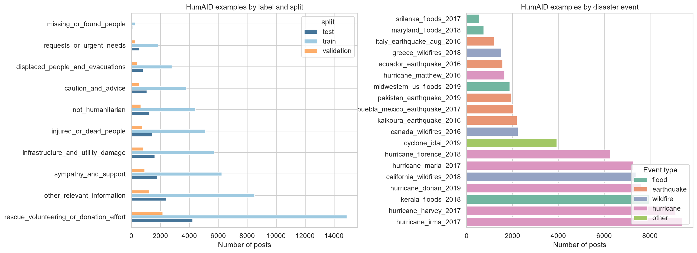

*Figure 1. HumAID label and event counts. Both label support and event coverage are uneven, with hurricane events contributing 41,320 of 76,484 messages. This concentration may reward event-specific language in the official split and motivated the unseen-event stress test.*

### 3.2 Supporting CrisisMMD analysis

CrisisMMD was inspected as a supporting dataset. It contains text–image pairs for informative, humanitarian and damage-severity tasks across seven disasters (Alam et al., 2018). It was not merged into the main training data because its tasks and label definitions differ from HumAID. One tweet may also appear once for each associated image, so a valid experiment would need to split and remove duplicates by `tweet_id`. Keeping it separate avoided an unclear target and accidental leakage.

### 3.3 Preparation and data quality

The EDA notebook downloads the public files, validates schemas and writes approved tables and figures. For modelling, URLs are removed, mentions become `@user`, hashtag words are retained and repeated whitespace is collapsed. This light normalisation keeps useful words, spelling patterns and hashtag content in short social-media messages.

The duplicate analysis found 12 exact duplicates and four normalised duplicate groups crossing official split boundaries. The number is small relative to the dataset, but it creates limited leakage risk and is reported as a limitation. Historical messages use `source_type=humaid_history` in the read-only index, while application submissions use `source_type=user` in SQLite.

## 4. NLP methods and system design

The main design decisions and their supporting evidence are summarised below:

| Problem | Chosen method | Evidence used in this report |
| --- | --- | --- |
| Uneven ten-class messages | TF-IDF baseline and Transformers | Macro-F1, per-label results and imbalance ablations |
| Unreliable confidence | Temperature scaling and review threshold | ECE and risk–coverage |
| Event shift | Twelve-event training with Cyclone Idai held out | Held-out performance and calibration |
| Similar situations | MiniLM with a display threshold | Blinded relevance judgements and Precision@K |
| Exact words and names | TF-IDF keyword search | Name-search and filter checks |
| Integrated use | FastAPI, SQLite and NiceGUI | API, failure, latency and demonstration evidence |

### 4.1 End-to-end architecture

The architecture separates modelling, retrieval, storage and presentation behind small backend interfaces.

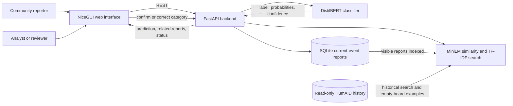

*Figure 2. CrisisLens architecture and data flow. Classification suggests a board; people retain control over the published category. Similar-report retrieval uses current-event reports, while HumAID remains a separate historical source.*

`classify(text)` returns a label, ten probabilities, confidence, model version and `needs_review`. Retrieval separates semantic `retrieve` from keyword `search`. The database preserves `predicted_label` when a user changes `board_label`.

`POST /api/analyse` searches only visible `source_type=user` reports already saved for the current event. It does not restrict results to the predicted board, because similar accounts may have been assigned different categories. MiniLM candidates below 0.45 cosine similarity are not shown; when no candidate reaches the threshold, the similar-report section is omitted. Saving a report or changing its board immediately updates the live index without waiting for an offline rebuild.

### 4.2 Transparent text baseline

Validation macro-F1 compared word, character and combined TF-IDF with LinearSVC and Logistic Regression. The selected model combines word 1–2 grams (`min_df=5`, 12,000 features) and character 3–5 grams (`min_df=10`, 16,000 features) with Logistic Regression (`C=1.0`, `max_iter=1000`, seed 42). Logistic Regression supplied probabilities for review routing. Balanced weights improved balanced accuracy but reduced macro-F1, so they were not used.

### 4.3 Contextual classifiers

DistilBERT was chosen as a compact general encoder (Sanh et al., 2019), while `cardiffnlp/twitter-roberta-base` supplied Twitter-specific pretraining (Barbieri et al., 2020). Both were fine-tuned for five epochs with batch size 32, learning rate `2e-5`, maximum length 128, warm-up ratio 0.1 and weight decay 0.01. These settings were fixed across runs; length 128 matched the tweet format, and exhaustive tuning was outside scope.

Plain fine-tuning, class weighting and focal loss were compared using a fixed rule: an alternative needed to improve F1 for at least two of the three smallest classes without reducing macro-F1 by more than 0.01. Neither alternative passed, so plain fine-tuning was retained.

DistilBERT was deployed because its validation macro-F1 of 0.7526 was only 0.0063 below Twitter-RoBERTa's 0.7589, while reducing recorded training time by about 50% and inference time by about 46%. On the test set, the macro-F1 gap remained 0.0074 and DistilBERT had lower calibrated ECE (0.0257 versus 0.0351). Twitter-RoBERTa remains an analysis model and is not loaded by the application.

### 4.4 Calibration and selective prediction

Temperature scaling was fitted to validation logits (Guo et al., 2017), giving `T = 1.1017` for DistilBERT and 1.3509 for Twitter-RoBERTa. Validation also selected the greatest coverage with accepted-sample error at or below 5%; DistilBERT's threshold was `tau = 0.8866`. Lower-confidence messages are shown to the submitter and flagged for administrator review, making the workload–risk trade-off explicit (Geifman & El-Yaniv, 2017).

### 4.5 Retrieval, search and duplicate grouping

Retrieval compared TF-IDF word matching with cosine similarity over normalised 384-dimensional `all-MiniLM-L6-v2` embeddings (Reimers & Gurevych, 2019; Wang et al., 2020). MiniLM was selected for similar reports and searches visible current-event reports across categories. Its 0.45 display threshold was the lowest value reaching 80% precision on 163 tuning judgements from the 1,427 labelled pairs. Relevance meant the same type of need, damage or situation, not proof of the same incident; the other 1,264 judgements were held out.

TF-IDF remained the method for explicit keyword search because it reliably finds exact words, names and numbers. Near-duplicates are grouped using cleaned-text TF-IDF similarity at a threshold of 0.90, preventing retweets and close copies from filling the first results. Search filters do not change the classification result.

### 4.6 Web application

FastAPI and Pydantic enforce the API contract. Before classification, links are removed, usernames become `@user`, hashtag symbols are removed and spaces are collapsed, matching training. SQLite keeps the user's original text with the prediction, current board, confidence, model version, review status, submitting account, optional location and timestamp.

New and corrected visible reports are added to the live retrieval index. Hiding a report removes it from the index, restoring it adds it again, and deletion removes it from both SQLite and the index.

NiceGUI calls the backend through REST. Demo mode works without the model and index; real mode fails visibly when required artefacts are missing.

## 5. Evaluation design

### 5.1 Classification protocol

Two separate classification settings were used and are not combined when interpreting results:

| Setting | Data construction | Purpose | Models and interpretation |
| --- | --- | --- | --- |
| Official HumAID benchmark | The published split: 53,531 training, 7,793 validation and 15,160 test messages across 19 events | Select the main models and compare them on a fixed benchmark | The TF-IDF baseline, DistilBERT and Twitter-RoBERTa results in Section 6.1. The deployed DistilBERT checkpoint comes from this setting. |
| Unseen-event stress test | The 13-event `events_set1_47K` subset, with every `cyclone_idai_2019` training and validation message removed; 779 Idai test messages | Measure transfer to a disaster excluded from model development | Each classifier was retrained on the remaining 12 events. These models are used only for the Section 6.3 shift analysis, not by the application. |

For the official benchmark, model selection used validation results and recorded training and inference time. Temperature scaling and review thresholds used validation data only. The test split was evaluated after these choices were fixed and was used for final reporting. Macro-F1 was the primary metric for all classifiers. Per-label precision, recall, F1 and support were also recorded. Accuracy, balanced accuracy and log loss were reported for the baseline only. Calibration was evaluated with 15-bin top-label ECE. Selective prediction was measured using coverage, accepted-sample risk and review rate.

### 5.2 Unseen-event stress test

The cross-event protocol removed all `cyclone_idai_2019` training and validation messages from the 13-event `events_set1_47K` subset. Models trained on the other 12 events and used transferred TF-IDF settings and review thresholds on 779 Idai test messages. This single-event stress test cannot establish broad robustness, so per-label support is reported without confidence intervals.

### 5.3 Retrieval protocol

Ten validation queries, one per category, selected the TF-IDF setting. The final comparison used 20 original test messages, two per category, and 10 paraphrases, one per category. Both methods searched only the 61,324 training and validation messages, so no test query could retrieve itself. Their top 20 results were pooled, shuffled and judged without revealing the method. A result was relevant when it described the same type of need, damage or situation as the query; a keyword-search result was relevant when it concerned the searched topic. The judgement file contains 1,427 records: 163 for tuning and 1,264 for final evaluation. Of the final records, 36 paraphrase results reused a judgement from the matching original query, leaving 1,391 direct manual judgements. One evaluator made these judgements, so inter-annotator agreement is not claimed. The released query and judgement files make the comparison auditable, while single-assessor subjectivity remains a limitation.

The primary metric was Precision@5 because users are most likely to inspect the first few results. Precision@10, pooled recall and query time were supporting measures.

Semantic retrieval would be adopted only if it improved overall Precision@5 by at least 0.05, matched or exceeded TF-IDF in at least six of ten categories, and remained below 200 ms per query.

### 5.4 System and interaction evaluation

The final automated suite contains 48 tests covering API contracts, the data path, moderation, current-event retrieval, classifier input cleaning, cross-event metrics, accessibility and frontend behaviour. After warm-up requests to health, analysis and search, seven endpoints were measured over 20 requests each. Fourteen live failure scenarios covered invalid and unusual input, missing or protected records, search, concurrent submissions and pagination.

The design review covered uncertainty, correction, privacy, status language, provenance, errors, responsive layout and accessibility (Appendix E). The demonstration walkthrough in Appendix D follows analysis, correction, publication, board redirection, retrieval and low-confidence review in the Nepal scenario. Figures 5–8 and Appendix F show the screens it passes through. It tests the implemented journey and is not presented as a formal usability study.

## 6. Results and findings

### 6.1 Official test classification

| Model | Role | Test macro-F1 | Calibration result | Cost observation |
| --- | --- | ---: | --- | --- |
| Word + character TF-IDF + Logistic Regression | Transparent baseline | 0.7262 | Native probabilities; ECE 0.0214 | 40.0 s training; 10.35 s for 15,160 test messages |
| DistilBERT | Application model | 0.7547 | ECE 0.0461 -> 0.0257 | 1,794 s training; 2.23 ms/sample |
| Twitter-RoBERTa | Analysis model | **0.7621** | ECE 0.0931 -> 0.0351 | 3,586.6 s training; 4.10 ms/sample |

*Table 1. Official HumAID test results. Runtime values come from the experiment environments and should be used for within-record comparisons, not as hardware-independent benchmarks.*

The contextual models improved macro-F1 over the lexical baseline. Twitter-RoBERTa gained 0.0359 absolute macro-F1, while DistilBERT gained 0.0285. A second Twitter-RoBERTa seed produced 0.7664; the two-seed mean was 0.7642 with a range of 0.0043. More seeds would strengthen uncertainty estimates, but the available result suggests that the DistilBERT–RoBERTa gap is small relative to their cost difference.

Per-label scores show that the main difficulty is not rare vocabulary alone. Models perform strongly on injured or dead people, infrastructure damage and rescue/donation messages. The weaker boundaries include `not_humanitarian` versus `other_relevant_information`, and requests versus donation or volunteering. These categories can use similar words while differing in communicative intent. Contextual encoders reduce but do not remove that ambiguity.

Class weighting and focal loss made the models predict minority labels more often. For DistilBERT, recall for `requests_or_urgent_needs` rose from 0.54 with plain fine-tuning to 0.71 with class weighting and 0.77 with focal loss. Precision fell as false positives increased, so minority-class F1 and overall macro-F1 did not improve. Plain fine-tuning was retained.

### 6.2 Selective prediction on seen data

The baseline threshold auto-accepted 36.48% of official test messages at 4.76% risk and routed 63.52% to review. It captured 92.90% of all baseline errors in the review queue. This is useful error concentration, but the workload is high.

DistilBERT auto-accepted 47.27% at 5.11% risk on seen test data. The risk is slightly above the validation target, showing that a threshold selected for 5% risk does not guarantee exactly 5% on later data. We treat confidence-based routing as a workload control with measured error, not as a safety guarantee.

Figure 3 shows the validation curve for the deployed DistilBERT. Re-running the released model on all 7,793 official validation messages produced macro-F1 of 0.7526 and recovered the released values `T = 1.1017` and `tau = 0.8866`. At this threshold, coverage was 46.9% and accepted-sample risk was 4.98%, meeting the 5% validation target. The results were generated by `scripts/distilbert_validation_curve.py`.

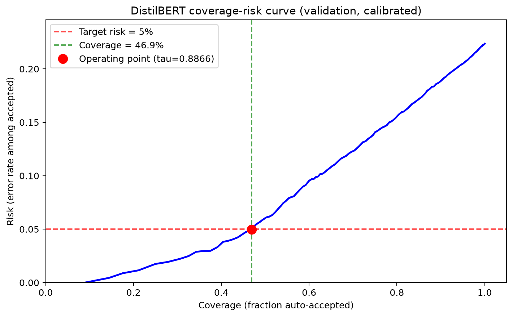

*Figure 3. DistilBERT coverage–risk curve on the official validation split. The deployed threshold `tau = 0.8866` retained 46.9% of messages at 4.98% risk.*

### 6.3 Unseen-event results

| Model | Held-out macro-F1 | Seen-to-held-out change | Coverage at frozen threshold | Accepted risk |
| --- | ---: | ---: | ---: | ---: |
| TF-IDF baseline | 0.5760 | −0.1502 | 26.83% | 5.26% |
| DistilBERT | 0.6969 | −0.0578 | 58.41% | 5.27% |
| Twitter-RoBERTa | **0.718** | −0.0441 | 36.8% | 1.1% |

*Table 2. Results on held-out `cyclone_idai_2019` (779 messages). In all three rows, the seen score comes from the official-split model and the held-out score comes from a separate model retrained on the other 12 events. These differences combine event shift with a change in training data and should be read descriptively.*

Both contextual models performed substantially better than the lexical baseline under the shared 12-event training and held-out-event setup. This supports the choice of a contextual classifier for the application.

Calibration behaved differently for the two models on the unseen event. Twitter-RoBERTa's frozen temperature changed ECE from 0.041 to 0.061, making calibration worse. DistilBERT's milder temperature changed ECE from 0.0473 to 0.0296, making it better. DistilBERT also retained higher automatic coverage, although its accepted risk drifted just above target. A deployed system would need to monitor both calibration and risk–coverage as new events arrive.

### 6.4 Retrieval and search

| Method or function | Precision@5 | Precision@10 | Mean query time |
| --- | ---: | ---: | ---: |
| TF-IDF related-message retrieval | 0.607 | 0.577 | 28.1 ms |
| Semantic related-message retrieval | **0.800** | **0.773** | 34.0 ms |
| TF-IDF keyword search | 0.756 | 0.733 | — |

*Table 3. Retrieval and search results. No standalone mean query time was recorded for the keyword-search relevance experiment. End-to-end `/api/search` latency is reported in Section 6.5.*

Semantic retrieval improved Precision@5 by 0.193 and was equal or better in nine of ten categories. The advantage was strongest for paraphrases, where Precision@5 was 0.82 compared with 0.52 for TF-IDF. It satisfied all three pre-defined selection conditions and became the default related-message method.

TF-IDF remained better for exact search. In the name-search test it found every message containing the target name within the top ten, while semantic retrieval found 31%–60% depending on name frequency. The two methods address different user intentions: semantic retrieval finds similar situations, while TF-IDF finds specific words and names.

Duplicate grouping increased the mean number of distinct results in the top ten from seven to ten, and all 29 filter checks passed. No tested threshold met the pre-defined 1% limit: eight of the 200 tuning results were grouped at every threshold. Manual inspection found that all eight were near-identical prayer messages. We kept 0.90 as a display rule, with every source record still available.

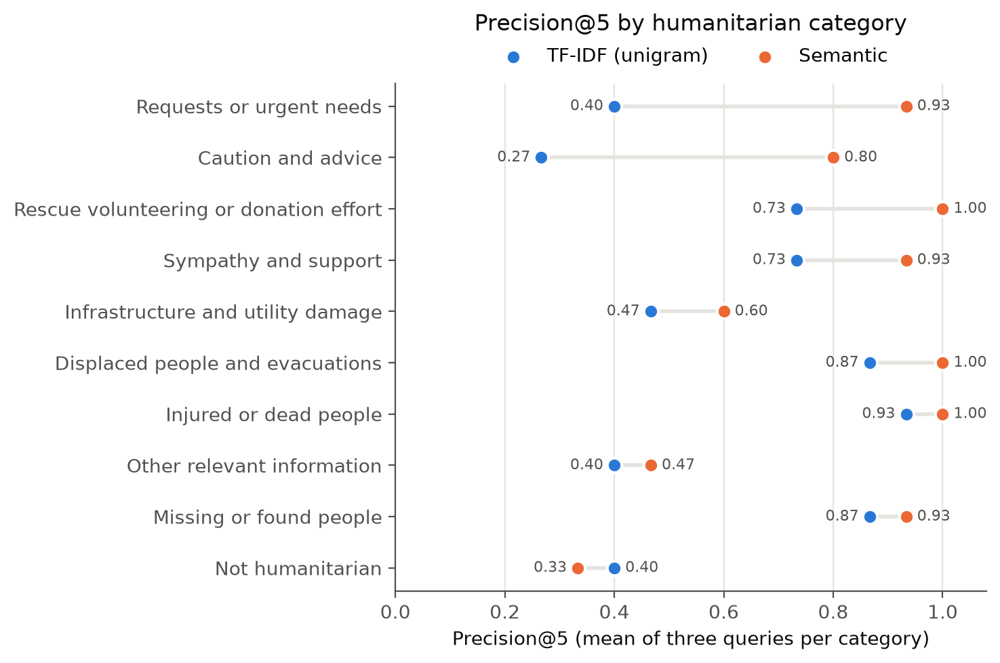

*Figure 4. Precision@5 by humanitarian category for TF-IDF and semantic retrieval.*

On the 1,264 held-out judgements, the 0.45 threshold displayed 75.8% relevant candidates and retained 83.1% of relevant candidates. This does not establish incident-level matching; within-event behaviour was checked only in small functional cases involving several reports about the same bridge.

### 6.5 System performance and reliability

On the final real-mode stack, `POST /api/analyse` had p50 latency of 127.6 ms and p95 of 213.6 ms. Creating a report had p50 latency of 164.6 ms, and listing reports took 4.0 ms at p50. Search had p50 latency of 40.0 ms and p95 of 1,078.7 ms. The measurements followed warm-up requests. The search tail appeared in the recorded run, but its cause was not isolated.

All 48 automated tests and all 14 live failure scenarios passed.

Ten concurrent submissions produced unique IDs without corruption. Blank input, invalid labels and missing reports returned clear 4xx errors; long and Unicode text were handled; and historical records remained read-only. The tests cover the expected prototype workflow, but they do not measure sustained load or production security.

## 7. Application and user interaction

### 7.1 Main journey

The application makes the model part of a short, reversible workflow:

1. The submission form limits the message to 2,000 characters and allows an optional approximate location.
2. The app displays the suggested category, confidence and any sufficiently similar reports already saved for the current event.
3. The user can keep or change the category before publication.
4. The saved report opens on its category board.
5. Readers can browse boards and search the current event by keyword and filters. They can switch to Historical dataset when they want to search past HumAID messages; the two modes do not mix results.
6. Low-confidence reports appear in the administrator review queue. An administrator can confirm or change the category without overwriting the original prediction.

Different people use CrisisLens for different reasons. Anyone can write a report without signing in, which avoids delaying the moment a person wants to share something. Signing in lets a person follow their own reports. The review queue and the administrator page are reserved for a demo administrator role, which illustrates how moderation could be kept apart from reporting but is not a security mechanism (Section 10).

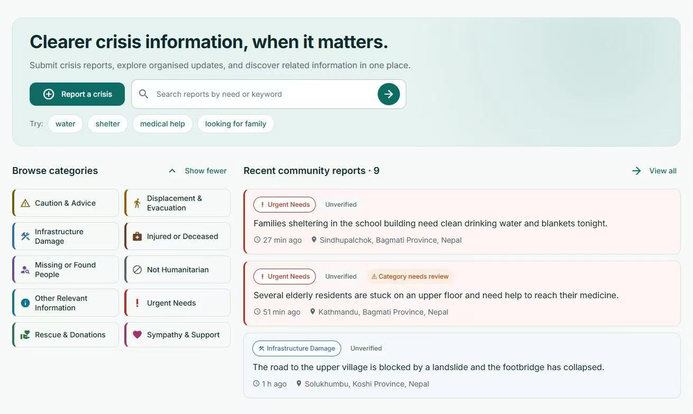

*Figure 5. The NiceGUI home page links to submission, search and all ten category boards. Demo records show the “Unverified” and “Category needs review” states.*

### 7.2 Ease of use and communication

The home page links directly to submission, search and category boards. The form separates description, category review and publication. Categories have consistent names, colours, icons and explanations, while loading, empty and error states provide a next action.

These choices respond to specific risks in a crisis setting. Editing the text resets the review step, so that a prediction made for old text cannot be published with new text. Confidence is shown as a percentage, and a highlighted alert appears when the model is unsure, as a bare label could be read as a fact. This follows guidance for human–AI interaction on showing how well a system can do what it does and on supporting correction (Amershi et al., 2019). Appendix E lists these risks with the design response to each.

The interface separates three ideas that could otherwise be confused:

- **Unverified** describes the truth status of a community report: CrisisLens has not fact-checked it.
- **Category needs review** means model confidence was below the threshold.
- **Category reviewed** means a person checked the sorting, not that the report is true.

The review queue shows the suggested category and confidence before confirmation or correction (Figure 6). A demo administrator can also hide, restore or delete inappropriate or repeated submissions. Hiding is reversible; permanent deletion asks for confirmation by default (Figure 11).

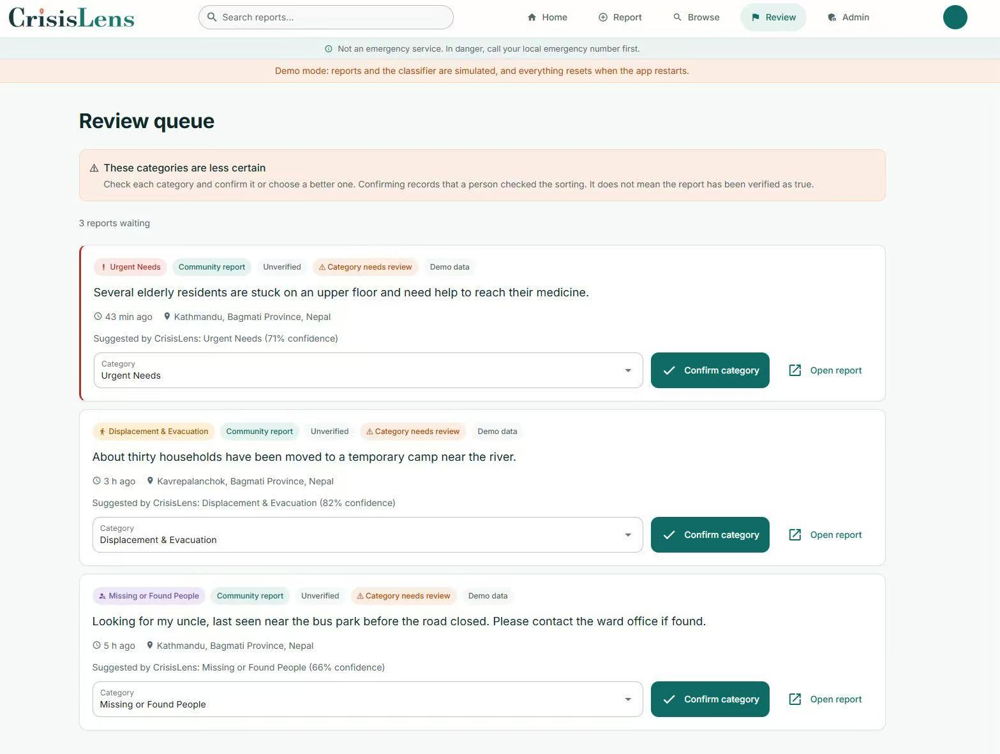

*Figure 6. The administrator review queue shows why a report is waiting and the controls for confirming or changing its category. The Nepal scenario uses preset confidence values to demonstrate these states; the values in this screenshot are not outputs from the deployed model.*

An empty board can show three HumAID cards with a dashed border, the label “Example · past disaster” and a notice that they are not current reports. They disappear once the board has a current-event report. Historical dataset search has its own page notice, and seeded records carry a “Demo data” label (Figures 9 and 10).

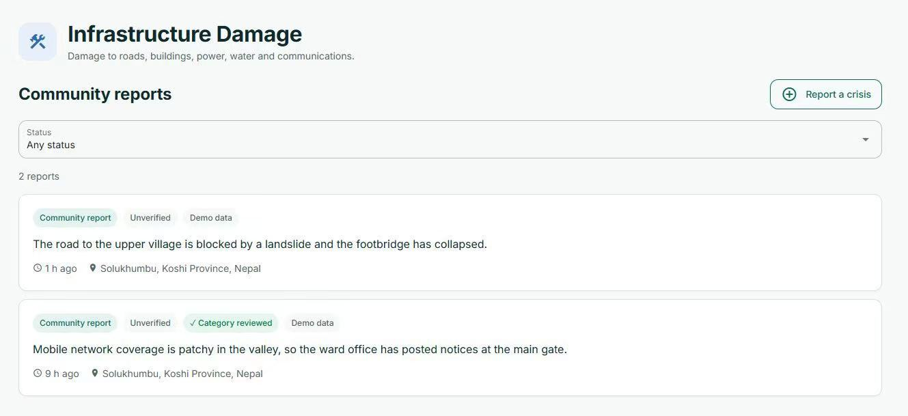

*Figure 7. A category board keeps source, verification and category-review status separate. The second demo record shows that “Category reviewed” refers to sorting, while the report itself remains “Unverified”.*

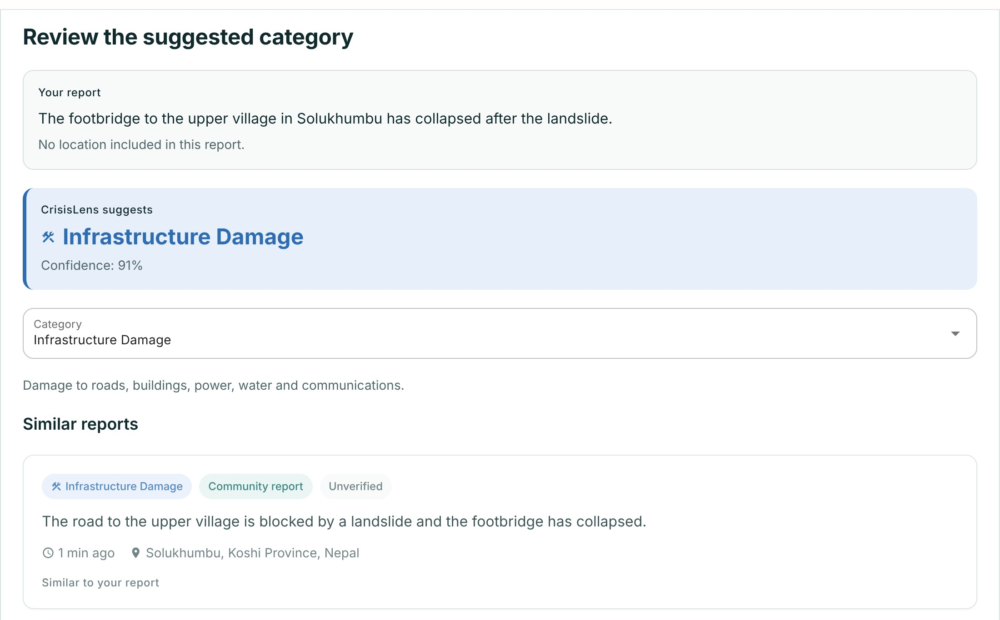

*Figure 8. Step 2 of the Nepal scenario submission in real mode. DistilBERT supplies the category and confidence, while the similar-report cards come from community reports already saved for the same event.*

### 7.3 Safety, privacy and accessibility

CrisisLens states that it is not an emergency service. The form discourages personal details; location is optional, confirmed before use and rounded before it is stored, as an exact position is rarely needed to sort a report. Map and geocoding services are disclosed. The responsive layout includes headings, a skip link, current-page navigation, keyboard focus and reduced-motion support. All 23 tested colour pairs met the WCAG 2.2 AA target, with a minimum contrast ratio of 4.57:1 (World Wide Web Consortium, 2024).

## 8. Outcomes and value added

CrisisLens provides a working path from an unstructured message to a searchable board entry. DistilBERT improved macro-F1 from 0.7262 to 0.7547, calibrated confidence routes review, and MiniLM links sufficiently similar current-event reports. TF-IDF supports exact search in current and historical modes. Publishing, correction, hiding, restoration and deletion update the live index while preserving the original prediction.

The held-out event exposed limits in calibration transfer, while semantic retrieval improved Precision@5 from 0.607 to 0.800. The repository packages the EDA, model interfaces, cross-event evaluator, retrieval index, REST schemas, tests and web interface needed to inspect or replace individual components.

## 9. Challenges and solutions

| Challenge | Response | Evidence |
| --- | --- | --- |
| Severe class imbalance | Used macro-F1 and per-label support; tested class weights and focal loss under a pre-defined decision rule | Neither alternative improved the agreed F1 condition, so plain fine-tuning was retained |
| Event-specific language and distribution shift | Added a 12-event training / one-event holdout stress test | Contextual models remained stronger; all models and thresholds changed under shift |
| Confidence could be misleading | Fitted temperature on validation and measured ECE plus risk–coverage | Seen ECE improved, while the held-out event exposed model-dependent transfer |
| Exact words and paraphrases need different retrieval | Evaluated TF-IDF and sentence embeddings under separate selection rules, then calibrated a display threshold | Semantic retrieval won for similar reports; TF-IDF won for names and keyword search |
| Repeated messages reduce useful result diversity | Added 0.90 near-duplicate grouping without deleting source records | Distinct top-ten results increased from seven to ten |
| Six independently developed components had to agree | Fixed ten labels and small classifier/retriever interfaces; used adapters and Pydantic validation | Integrated API tests and live failure scenarios passed |
| Users could over-trust labels or reports | Separated prediction, board correction and verification language | Interface shows confidence, review state, “Unverified”, demo provenance and a separate historical mode |

## 10. Ethics, limitations and responsible use

**Dataset coverage and fairness.** HumAID contains public English tweets from selected 2016–2019 disasters and over-represents hurricanes. It does not cover every language, region or communication practice. Group-level performance was not measured, and language should not be used to infer personal characteristics.

**Rare classes and event coverage.** The official test has only 72 `missing_or_found_people` messages and the held-out event has four, making those scores unstable. One held-out event cannot support broad robustness claims.

**Verification and moderation.** CrisisLens sorts but does not verify reports. Administration uses fixed demo accounts without secure backend authorisation or an audit history. Category changes are restricted to the author or an administrator at the interface only. The backend does not verify identity: the author is a name sent by the client, and a person can still choose any category when publishing, which is not checked against the model's suggestion. A public version needs secure accounts, role checks, rate limits and moderation records.

**Privacy and data governance.** Reports may contain personal information despite the form warning. Retention, withdrawal and incident-response policies are not implemented. Historical tweets remain subject to dataset terms and privacy requirements.

**Evidence still needed.** The project lacks an external usability study, screen-reader test, sustained load test and verified public deployment. Confidence percentages may be over-interpreted. Human review therefore needs defined roles and monitoring rather than being treated as a final safeguard (National Institute of Standards and Technology, 2023).

## 11. Recommendations and next steps

A later usability study should test whether new users distinguish confidence, category review and factual verification. Multi-event holdouts should cover more disaster types, while monitoring tracks per-class errors, ECE, review coverage and corrections.

Retrieval work should test time and approximate-location ranking, crisis-specific encoders and hybrid scores. Reports could be reviewed and archived into historical mode when an event ends. Other priorities are low-bandwidth operation and multilingual models.

For future releases, the team should repeat the real workflow from a clean environment and preserve the tested code version, dependency lock and application evidence together. The current prototype treats local reproducibility as its main deployment evidence; a public service would require separate operational and security checks.

CrisisLens currently runs the NiceGUI frontend and FastAPI backend as separate processes. Reports are stored in a local SQLite database, while the retrieval index remains in memory. The measured p50 latency for a real-stack analysis request was 127.6 ms, but this experiment did not measure production capacity. At higher traffic, SQLite's serialised writes and a separate in-memory index for each API process would limit throughput and consistency. A larger deployment would therefore need a server database, a shared persistent retrieval service and multiple API workers behind a load balancer.

**Abuse prevention.** Administrators can hide, restore or delete submissions. A public version should detect repeats, rate-limit posting and record moderation reasons without treating an NLP prediction as evidence of malicious intent.

## References

Alam, F., Ofli, F., & Imran, M. (2018). CrisisMMD: Multimodal Twitter datasets from natural disasters. *Proceedings of the 12th International AAAI Conference on Web and Social Media*. https://crisisnlp.qcri.org/crisismmd

Alam, F., Qazi, U., Imran, M., & Ofli, F. (2021). HumAID: Human-annotated disaster incidents data from Twitter with deep learning benchmarks. *Proceedings of the International AAAI Conference on Web and Social Media, 15*(1), 933–942. https://doi.org/10.1609/icwsm.v15i1.18116

Amershi, S., Weld, D., Vorvoreanu, M., Fourney, A., Nushi, B., Collisson, P., Suh, J., Iqbal, S., Bennett, P. N., Inkpen, K., Teevan, J., Kikin-Gil, R., & Horvitz, E. (2019). Guidelines for human-AI interaction. In *Proceedings of the 2019 CHI Conference on Human Factors in Computing Systems*. ACM. https://doi.org/10.1145/3290605.3300233

Barbieri, F., Camacho-Collados, J., Espinosa Anke, L., & Neves, L. (2020). TweetEval: Unified benchmark and comparative evaluation for tweet classification. In *Findings of the Association for Computational Linguistics: EMNLP 2020* (pp. 1644–1650). Association for Computational Linguistics. https://doi.org/10.18653/v1/2020.findings-emnlp.148

CrisisNLP. (n.d.). *Resources for research on crisis informatics topics*. Retrieved October 13, 2026, from https://crisisnlp.qcri.org/

Geifman, Y., & El-Yaniv, R. (2017). Selective classification for deep neural networks. *arXiv*. https://doi.org/10.48550/arXiv.1705.08500

Guo, C., Pleiss, G., Sun, Y., & Weinberger, K. Q. (2017). On calibration of modern neural networks. In *Proceedings of the 34th International Conference on Machine Learning* (Vol. 70, pp. 1321–1330). PMLR. https://proceedings.mlr.press/v70/guo17a.html

Imran, M., Castillo, C., Lucas, J., Meier, P., & Vieweg, S. (2014). AIDR: Artificial intelligence for disaster response. In *Proceedings of the 23rd International Conference on World Wide Web Companion* (pp. 159–162). https://doi.org/10.1145/2567948.2577034

National Institute of Standards and Technology. (2023). *Artificial intelligence risk management framework (AI RMF 1.0)* (NIST AI 100-1). https://doi.org/10.6028/NIST.AI.100-1

Nielsen, J. (1994, April 24). *10 usability heuristics for user interface design*. Nielsen Norman Group. https://www.nngroup.com/articles/ten-usability-heuristics/

Okolloh, O. (2009). Ushahidi or 'testimony': Web 2.0 tools for crowdsourcing crisis information. *Participatory Learning and Action, 59*, 65–70. https://www.iied.org/g02842

Reimers, N., & Gurevych, I. (2019). Sentence-BERT: Sentence embeddings using Siamese BERT-networks. In *Proceedings of the 2019 Conference on Empirical Methods in Natural Language Processing and the 9th International Joint Conference on Natural Language Processing* (pp. 3982–3992). Association for Computational Linguistics. https://doi.org/10.18653/v1/D19-1410

ReliefWeb. (n.d.). *All about the ReliefWeb API*. Retrieved October 13, 2026, from https://apidoc.reliefweb.int/

Sanh, V., Debut, L., Chaumond, J., & Wolf, T. (2019). DistilBERT, a distilled version of BERT: Smaller, faster, cheaper and lighter. *arXiv*. https://doi.org/10.48550/arXiv.1910.01108

Wang, W., Wei, F., Dong, L., Bao, H., Yang, N., & Zhou, M. (2020). MiniLM: Deep self-attention distillation for task-agnostic compression of pre-trained Transformers. *Advances in Neural Information Processing Systems, 33*, 5776–5788.

World Wide Web Consortium. (2024). *Web Content Accessibility Guidelines (WCAG) 2.2*. https://www.w3.org/TR/WCAG22/

## Appendix A. Reproducibility

Runtime values are reported only as measurements from the recorded experiment environments because hardware differed across team members. The repository supports Python 3.11 or later, and `pyproject.toml` with `uv.lock` records the shared environment.

```bash
uv sync
uv run jupyter lab
```

Run all cells in `notebooks/01_crisis_eda.ipynb`; it downloads missing public data into `data/raw/` and writes the shared EDA outputs to `outputs/eda/`. Download `model.safetensors` from the repository's `m3-transformer-v2` release and place it in `models/transformer/`; the loader, metadata, configuration and tokenizer files are already tracked in Git. Then build the historical index:

```bash
uv run python models/retrieval/build_index.py
```

Start the real backend and frontend in separate terminals:

```bash
CRISISLENS_RUNTIME=real uv run uvicorn app.backend.main:app --host 0.0.0.0 --port 8000
CRISISLENS_API_URL=http://localhost:8000 uv run python app/frontend/main.py
```

Open `http://localhost:8080`. `GET /api/health` should report the real classifier and retrieval components before evidence is captured.

With the backend running, `scripts/demo_data.py` prepares the reports used in a demonstration:

```bash
uv run python scripts/demo_data.py empty --yes
uv run python scripts/demo_data.py nepal --replace
uv run python scripts/demo_data.py event kerala_floods_2018 --limit 40 --replace
```

`empty` removes all community reports and requires `--yes`. `nepal` loads the nine labelled scenario reports used by the frontend demonstration. `event <name>` samples the named event's HumAID test split, sends each message through the running classifier and marks the saved records as demo data. Event loading requires the per-event files downloaded by `notebooks/01_crisis_eda.ipynb`; `uv run python scripts/demo_data.py event --list` shows the available names.

With the real backend running, the following script checks the active runtime, classification, related-message retrieval, report creation and authorship, public listing, hide and restore behaviour, review status, date-filtered search and deletion:

```bash
uv run python scripts/real_mode_check.py
```

The script gives its temporary reports a unique marker and deletes them when a run completes normally.

The retrieval display threshold and the deployed DistilBERT validation curve can be reproduced separately:

```bash
uv run python scripts/calibrate_related_threshold.py
uv run python scripts/distilbert_validation_curve.py
```

The first script uses the released relevance judgements to write `related_threshold.csv`. The second reruns the released DistilBERT on the official validation split and writes the validation summary and Figure 3.

Run the automated suite from the repository root:

```bash
uv run pytest tests/ -v
```

The suite contains 48 automated tests, and all passed with the local MiniLM model and retrieval index available. It covers API contracts, classifier input cleaning, current-event retrieval and threshold behaviour, live-index updates, moderation and authorship, database migration, date-filtered API search, demo-mode consistency, colour contrast, frontend response handling and cross-event evaluation.

The selected Transformer checkpoint is stored in `models/transformer/`, the locally generated retrieval index in `models/retrieval/index/`, and the persisted user reports in the SQLite database used by the backend. See the repository README for platform-specific environment-variable syntax and the current model-release URL.

## Appendix B. Main artefacts

| Evidence | Path |
| --- | --- |
| EDA notebook and outputs | `notebooks/01_crisis_eda.ipynb`, `outputs/eda/` |
| Baseline model and results | `models/text_baseline/`, `outputs/results/baseline/` |
| Transformer metadata and results | `models/transformer/metadata.json`, `outputs/results/transformer/distilbert_validation_curve.json`, `outputs/results/transformer/distilbert_coverage_risk_curve.png` |
| Cross-event results | `outputs/results/cross_event/` |
| Retrieval implementation and results | `models/retrieval/`, `outputs/results/retrieval/`, `outputs/results/retrieval/related_threshold.csv` |
| Backend and database | `app/backend/`, `app/schema.sql` |
| Frontend | `app/frontend/` |
| System timing, failure scenarios and contrast check | `outputs/results/system/endpoint_latency.json`, `outputs/results/system/failure_scenarios.json`, `outputs/results/system/contrast_check.csv` |
| Interaction design and demonstration flow | `app/frontend/`, `report/sections/member6_frontend_and_user_study.md` |

## Appendix C. REST endpoints

| Method | Path | Purpose |
| --- | --- | --- |
| POST | `/api/analyse` | Classify a draft and retrieve similar reports saved for the current event |
| POST | `/api/reports` | Save a user report |
| GET | `/api/reports` | List and filter saved reports, including a `created_by` filter used by My Reports |
| GET | `/api/reports/{id}` | Show one report and similar reports from the current event |
| PATCH | `/api/reports/{id}` | Correct the board, update review status, or hide and restore a report |
| DELETE | `/api/reports/{id}` | Delete a community report |
| GET | `/api/search` | Keyword search with an optional `source_type`; the interface always selects either Current event or Historical dataset |
| GET | `/api/health` | Show runtime and component status |

## Appendix D. Demonstration walkthrough

1. Start the real backend, load the Nepal scenario with `uv run python scripts/demo_data.py nepal --replace`, and confirm that `GET /api/health` reports the real DistilBERT classifier and retrieval index.
2. Submit a bridge-related crisis message and inspect the category and confidence produced by DistilBERT. The similar-report cards should contain only saved reports from the current Nepal event.
3. Confirm or correct the category, publish the report and follow the redirect to its board.
4. Browse the board, open a report and search the Current event with a filter. Switch to Historical dataset to show that past HumAID messages are searched separately.
5. Show how a low-confidence prediction appears in the review queue without being presented as fact-checked.
6. Open the administrator page and show how a repeated or inappropriate submission can be hidden, restored or deleted. Explain that the demo login is not intended for public deployment.

## Appendix E. Interface design review

The interface was reviewed by the team against Nielsen's usability heuristics (Nielsen, 1994), the guidelines for human–AI interaction (Amershi et al., 2019) and WCAG 2.2 (World Wide Web Consortium, 2024). The table pairs each risk with the design response, the principle it applies and where it appears.

| Risk | Design response | Principle | Where |
| --- | --- | --- | --- |
| A person may trust a model guess as a fact | Every community report carries an "Unverified" badge; "Category reviewed" only means a person checked the category | Visibility of system status (Nielsen) | Figures 5–7 |
| A person may not understand the confidence | Confidence is shown as a percentage; a highlighted alert and the review queue handle uncertain predictions | Make clear how well the system can do what it can do; scope services when in doubt (Amershi et al.) | Figures 6, 8 |
| The model may be wrong and a person may not be able to correct it | The person can change the category before publishing; the original model suggestion is kept | Support efficient correction (Amershi et al.); user control and freedom (Nielsen) | Section 7.1 |
| A person may share personal or exact location data | A privacy reminder, an optional location confirmed by the person, and coordinates rounded to about 1 km and drawn as a circle | Error prevention (Nielsen) | Section 7.3 |
| The tool may be mistaken for an emergency service | A safety line on every page except the form, a larger box with emergency numbers on the form, and a footer note | Make clear what the system can do (Amershi et al.) | Section 7.3 |
| Past disasters may look current | Historical results are labelled, marked as not current and shown with usernames anonymised and links removed; empty boards show clearly marked examples | Visibility of system status (Nielsen) | Figures 9, 10 |
| Small screens, keyboard use or low contrast may make the interface harder to use | A skip link, visible focus styles, semantic headings, a layout that adapts to phones, and colour pairs checked against WCAG 2.2 AA (23 pairs, lowest ratio 4.57:1) | Accessibility (WCAG 2.2) | Section 7.3 |

## Appendix F. Additional interface screens

These screens were captured from the same build as Figures 5–8 and show the states described in Section 7.2 that the main figures do not cover.

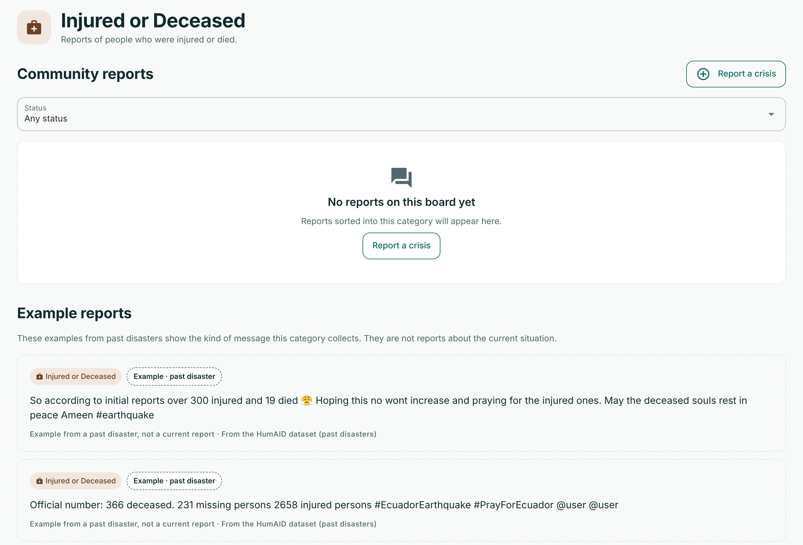

*Figure 9. An empty board in real mode. The HumAID example cards below the empty state have a dashed border and the label “Example · past disaster”, and a notice states that they are not reports about the current situation.*

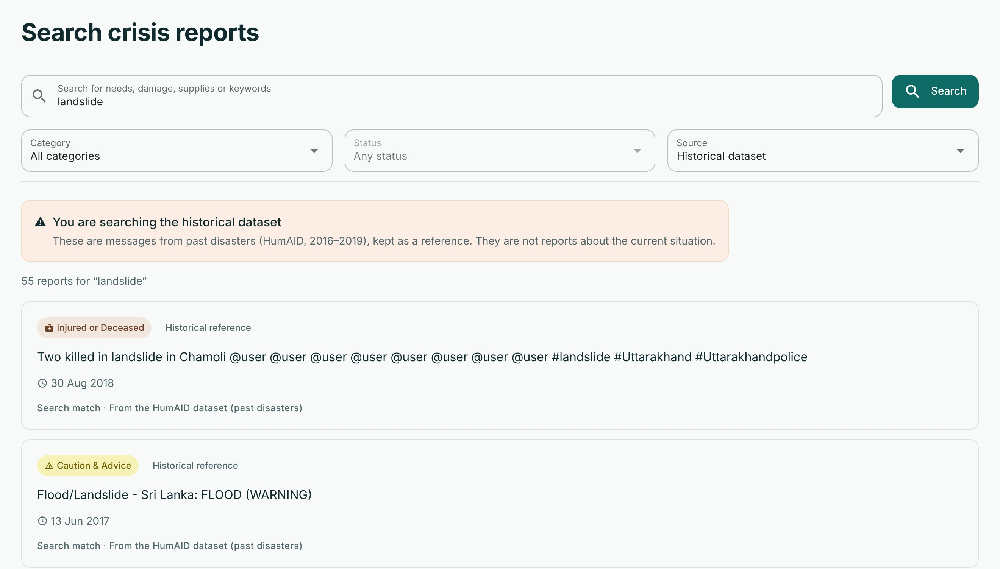

*Figure 10. Historical dataset search in real mode. A page notice states that the results are past HumAID messages, and the status filter is disabled because review status applies only to community reports.*

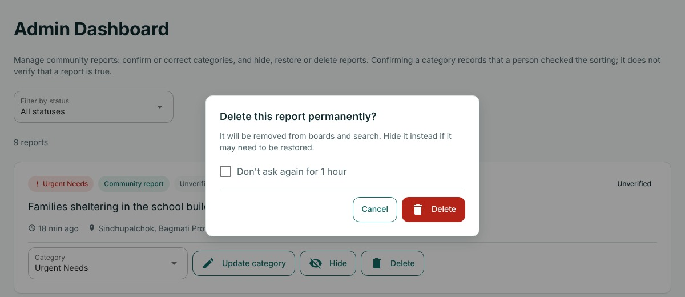

*Figure 11. Permanent deletion on the administrator page asks for confirmation and suggests hiding instead. The administrator can skip the confirmation for one hour. The records behind the dialog are demo data.*
